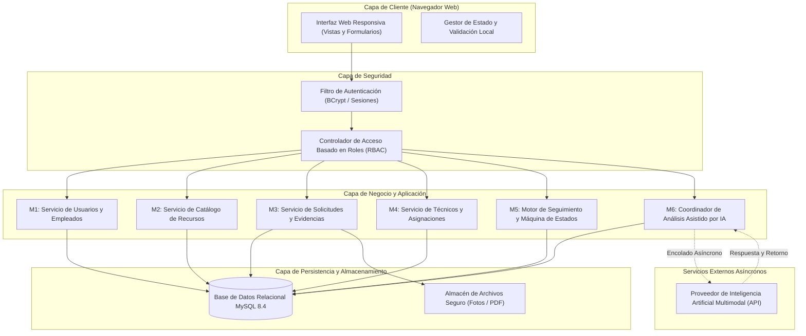
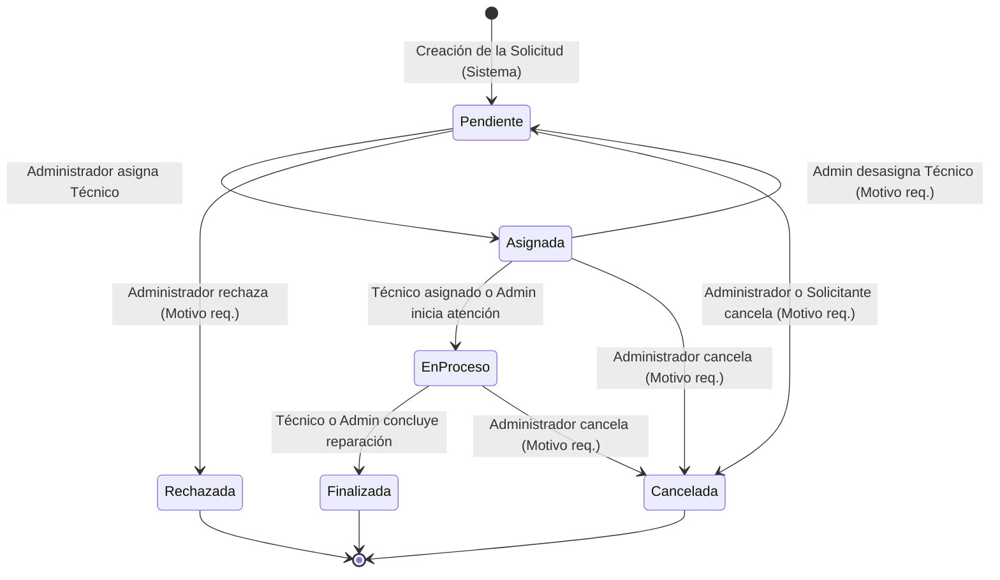
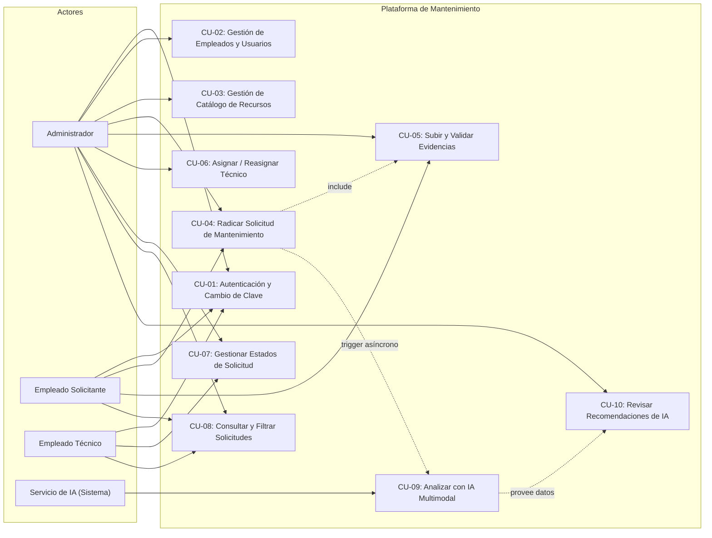

# ESPECIFICACIÓN DE REQUERIMIENTOS DE SOFTWARE (SRS)

**PROYECTO:** PLATAFORMA DE GESTIÓN INTEGRAL DE SOLICITUDES DE MANTENIMIENTO CON ANÁLISIS ASISTIDO POR IA  
**DOCUMENTO:** Software Requirements Specification (SRS)  
**VERSIÓN:** 1.0  
**FECHA DE EMISIÓN:** 14 de noviembre de 2026  
**ESTÁNDAR DE REFERENCIA:** IEEE Std 830-1998 / ISO/IEC/IEEE 29148:2018  
**ESTADO:** Aprobado para Fase de Construcción y Aseguramiento de Calidad (QA)  

---

## Tabla de Contenido
1. [Introducción](#1-introducción)
   - 1.1 [Planteamiento del Problema](#11-planteamiento-del-problema)
   - 1.2 [Propósito del Documento](#12-propósito-del-documento)
   - 1.3 [Justificación y Análisis de Retorno](#13-justificación-y-análisis-de-retorno)
     - 1.3.1 [Vigilancia Tecnológica y Referentes de Mercado](#131-vigilancia-tecnológica-y-referentes-de-mercado)
   - 1.4 [Objetivos](#14-objetivos)
     - 1.4.1 [Objetivo General](#141-objetivo-general)
     - 1.4.2 [Objetivos Específicos](#142-objetivos-específicos)
   - 1.5 [Alcances del Sistema](#15-alcances-del-sistema)
     - 1.5.1 [Alcance Incluido (Línea Base Confirmada)](#151-alcance-incluido-línea-base-confirmada)
     - 1.5.2 [Alcance Condicionado y Supuestos Provisionales](#152-alcance-condicionado-y-supuestos-provisionales)
     - 1.5.3 [Alcance Excluido (Evolución y Mejoras Futuras)](#153-alcance-excluido-evolución-y-mejoras-futuras)
   - 1.6 [Personal Involucrado y Roles del Proyecto](#16-personal-involucrado-y-roles-del-proyecto)
   - 1.7 [Definiciones, Acrónimos y Abreviaturas](#17-definiciones-acrónimos-y-abreviaturas)
   - 1.8 [Referencias Normativas y Documentales](#18-referencias-normativas-y-documentales)
   - 1.9 [Resumen Ejecutivo](#19-resumen-ejecutivo)
2. [Descripción General](#2-descripción-general)
   - 2.1 [Perspectiva del Producto y Arquitectura de Alto Nivel](#21-perspectiva-del-producto-y-arquitectura-de-alto-nivel)
   - 2.2 [Características y Taxonomía de Usuarios](#22-características-y-taxonomía-de-usuarios)
   - 2.3 [Matriz Canónica de Permisos y Control de Acceso](#23-matriz-canónica-de-permisos-y-control-de-acceso)
   - 2.4 [Máquina de Estados y Ciclo de Vida de Solicitudes](#24-máquina-de-estados-y-ciclo-de-vida-de-solicitudes)
   - 2.5 [Restricciones Técnicas y Regulatorias](#25-restricciones-técnicas-y-regulatorias)
   - 2.6 [Suposiciones y Dependencias](#26-suposiciones-y-dependencias)
3. [Requisitos Específicos](#3-requisitos-específicos)
   - 3.1 [Requisitos de Interfaces Externas](#31-requisitos-de-interfaces-externas)
   - 3.2 [Historias de Usuario (HU-01 a HU-20)](#32-historias-de-usuario)
   - 3.3 [Diagramas de Casos de Uso del Sistema](#33-diagramas-de-casos-de-uso-del-sistema)
   - 3.4 [Especificación Exhaustiva de Requerimientos Funcionales (RF-01 a RF-20)](#34-especificación-exhaustiva-de-requerimientos-funcionales)
   - 3.5 [Especificación de Requerimientos No Funcionales (RNF-01 a RNF-12)](#35-especificación-de-requerimientos-no-funcionales)
   - 3.6 [Matriz de Trazabilidad de Requerimientos](#36-matriz-de-trazabilidad-de-requerimientos)

---

# 1. Introducción

El presente documento define la Especificación de Requerimientos de Software (SRS) para la **Plataforma de Solicitudes de Mantenimiento**. Este sistema constituye la solución tecnológica corporativa para centralizar, digitalizar, canalizar, asignar y auditar el ciclo de vida de los reportes de incidentes, averías y solicitudes de mantenimiento correctivo y preventivo de activos físicos (equipos de cómputo y tecnológicos, infraestructura y edificaciones, maquinaria industrial y herramientas de precisión) pertenecientes a una organización.

El diseño del software incorpora además un componente de inteligencia artificial multimodal (visión computacional y procesamiento de lenguaje natural) concebido como un asistente técnico que analiza descripciones y evidencias adjuntas (fotografías y documentos técnicos en PDF) con el propósito de generar recomendaciones preliminares de tipología de falla, categoría técnica y nivel de severidad o prioridad, asegurando en todo momento que la toma de decisiones finales permanezca bajo supervisión y validación humana calificada.

### 1.1 Planteamiento del Problema

En el ecosistema operativo corporativo, el mantenimiento de los activos representa una función crítica para garantizar la continuidad del negocio, la seguridad del personal y la preservación de la vida útil de los recursos de capital. Sin embargo, las organizaciones que carecen de un sistema centralizado de gestión experimentan una serie de deficiencias estructurales:

1. **Dispersión y pérdida de reportes de fallas:** Los incidentes son comunicados a través de canales no estructurados ni trazables (mensajería instantánea, correos electrónicos aislados, notas verbales o planillas físicas en papel). Esto produce la pérdida de solicitudes, duplicidad de esfuerzos y falta de comprobantes fidedignos sobre la fecha y hora exacta en que se detectó la falla.
2. **Ausencia de inventario centralizado de activos y ubicación:** Al momento de registrar una avería, no existe validación rigurosa sobre el código oficial, modelo o localización física del activo afectado, lo que ocasiona desplazamientos innecesarios del personal de mantenimiento o reparaciones aplicadas al equipo incorrecto.
3. **Carencia de evidencia técnica verificable:** Las solicitudes habitualmente carecen de fotografías o diagramas del daño al momento de originarse el problema. Cuando la intervención técnica se lleva a cabo, los especialistas no cuentan con insumos visuales previos, incrementando los tiempos de diagnóstico.
4. **Subjetividad e inconsistencia en la priorización:** La determinación de qué avería atender primero suele depender de la insistencia del solicitante y no de un criterio técnico objetivo de criticidad operacional, provocando que fallas graves queden desatendidas mientras se resuelven inconvenientes menores.
5. **Opacidad y falta de trazabilidad en el ciclo de resolución:** Ni los empleados solicitantes ni la administración conocen con certeza el estado actual de un requerimiento (si ha sido asignado, a qué especialista se entregó, si se encuentra en diagnóstico o si se ha cerrado), generando desconfianza interna y fricciones operativas.

A partir de este escenario, se formula la siguiente pregunta problema que guía el desarrollo de la plataforma:

> **Pregunta Problema:**  
> *¿De qué manera un sistema web centralizado, estructurado bajo un modelo de control de acceso por roles, con máquina de estados finitos y soporte de análisis asistido por Inteligencia Artificial, optimiza el ciclo de vida de las solicitudes de mantenimiento, asegurando trazabilidad integral de activos, rigor técnico en la asignación y reducción de los tiempos de atención en una organización?*

---

### 1.2 Propósito del Documento

El propósito primordial de esta Especificación de Requerimientos de Software (SRS) es:

- Delimitar formal, técnica y contractualmente las capacidades, comportamientos, restricciones y atributos de calidad de la plataforma.
- Servir como guía base e inalterable para los equipos de arquitectura de software, desarrollo frontend/backend, control y aseguramiento de calidad (QA Tester) y administradores de infraestructura.
- Proveer criterios de aceptación inequívocos y verificables que permitan validar la conformidad del sistema frente a los casos de uso esperados.
- Establecer la matriz de trazabilidad que vincula cada necesidad del negocio con su correspondiente historia de usuario, requerimiento funcional, clase UML y entidad del modelo de datos relacional.

---

### 1.3 Justificación y Análisis de Retorno

La implementación de la plataforma se justifica tanto a nivel técnico como económico y operativo:

- **Reducción del Tiempo Medio de Reparación (MTTR - *Mean Time To Repair*):** Al estructurar el reporte con fotografías y categorización instantánea, los técnicos disponen de un diagnóstico preliminar antes de acudir al sitio de la falla, reduciendo hasta en un 35% los tiempos muertos de inspección.
- **Auditoría e Integridad Histórica:** La preservación de historiales de estado inmutables con usuario, fecha, hora y motivo permite a la gerencia técnica identificar activos con fallas crónicas o recurrentes, facilitando decisiones informadas sobre reemplazo de maquinaria frente a reparaciones continuas.
- **Eficiencia en la Supervisión Administrativa:** La automatización de estados (Pendiente, Asignada, En proceso, Finalizada, Cancelada, Rechazada) elimina los cuellos de botella de comunicación manual entre solicitantes y ejecutores.
- **Adopción Asistida por Inteligencia Artificial:** La incorporación de visión artificial y modelos de lenguaje para clasificar fallas disminuye la carga cognitiva del administrador, homogenizando la priorización de las solicitudes.

#### 1.3.1 Vigilancia Tecnológica y Referentes de Mercado

Para sustentar la elección arquitectónica y de alcance del proyecto, se evaluaron los principales enfoques del mercado frente a la gestión de mantenimiento corporativo:

| Enfoque / Referente de Mercado | Tipo de Solución | Aportes Identificados | Limitaciones Observadas | Justificación de la Solución Propuesta |
| :--- | :--- | :--- | :--- | :--- |
| **Sistemas CMMS Tradicionales Empresariales (ej. IBM Maximo, SAP Plant Maintenance)** | Plataforma ERP de gestión de activos a gran escala. | Extensa profundidad en órdenes de trabajo, inventario de repuestos y control de costos. | Elevadísimo costo de licenciamiento, interfaces de usuario complejas y curvas de aprendizaje de varios meses; excesivo para medianas y pequeñas operaciones. | La plataforma ofrece un flujo ágil, enfocado en incidentes, de adopción inmediata y sin sobrecarga administrativa. |
| **Sistemas de Mesa de Ayuda Genéricos (ej. Jira Service Management, Zendesk)** | Plataformas de Help Desk para tickets de servicios IT. | Flujo de estados configurable y gestión colaborativa de tickets. | Diseñados para soporte lógico/ofimático; carecen de un modelo nativo para activos físicos clasificados en 4 clases (edificios, maquinaria, herramientas, equipos) y no incorporan análisis de visión sobre daños físicos. | Nuestro sistema modela nativamente los activos físicos, sus ubicaciones y aplica IA multimodal directamente sobre fotos de piezas y estructuras. |
| **Gestión Manual Desestructurada (Hojas de Cálculo y Mensajería)** | Archivos compartidos en Excel/Sheets y grupos de chat. | Nulo costo financiero inicial y máxima flexibilidad aparente. | Inexistencia de control de concurrencia, pérdida de evidencias fotográficas, vulnerabilidad de seguridad y cero garantías de no repudio o trazabilidad. | La plataforma proporciona integridad referencial estricta, bases de datos relacionales ACID y auditoría completa de acciones. |

---

### 1.4 Objetivos

#### 1.4.1 Objetivo General
Diseñar, implementar e integrar una plataforma web robusta para la gestión corporativa de solicitudes de mantenimiento en una organización, que centralice el inventario de activos clasificados, gestione el flujo de solicitudes a través de una máquina de seis estados, regule la asignación a empleados técnicos y asista el análisis descriptivo y de criticidad mediante inteligencia artificial multimodal.

#### 1.4.2 Objetivos Específicos
1. **Módulo M1 - Identidad y Seguridad:** Implementar el control de acceso, registro de empleados y autenticación de usuarios mediante credenciales seguras, segregando perfiles de Administrador y Empleado con políticas estrictas de sesión.
2. **Módulo M2 - Gestión de Activos:** Construir el catálogo maestro de recursos físicos clasificados obligatoriamente en cuatro tipologías (Equipo tecnológico, Instalación o edificio, Maquinaria y Herramienta), garantizando su localización física y estado operativo.
3. **Módulo M3 - Registro y Evidencias:** Desarrollar el mecanismo de radicación de solicitudes por parte de solicitantes o administradores, integrando la captura de descripciones detalladas y adjunción de evidencias documentales (PDF) y gráficas (JPEG/PNG) con validación de tipo MIME por contenido.
4. **Módulo M4 - Técnicos y Asignaciones:** Establecer el módulo de gestión técnica que distinga a los empleados con labores de mantenimiento y permita la asignación y reasignación manual de solicitudes, conservando una única asignación activa y un registro histórico de intervenciones.
5. **Módulo M5 - Trazabilidad y Estados:** Implementar la máquina de estados estricta (Pendiente &rarr; Asignada &rarr; En proceso &rarr; Finalizada / Cancelada / Rechazada), asegurando el registro de auditoría con motivo para cancelaciones y rechazos.
6. **Módulo M6 - Asistencia por Inteligencia Artificial:** Integrar un conector asíncrono con servicios de IA multimodal para evaluar la descripción y archivos adjuntos de las solicitudes, generando sugerencias de tipo de daño, categoría y prioridad, las cuales deberán ser expresamente aceptadas, modificadas o descartadas por la administración.

---

### 1.5 Alcances del Sistema

#### 1.5.1 Alcance Incluido (Línea Base Confirmada)
- Aplicación web con diseño responsivo operable en dispositivos móviles y de escritorio.
- Gestión de usuarios y empleados bajo dos perfiles: **Administrador** y **Empleado**.
- Identificación de la función de **Empleado Técnico** como atributo funcional sobre la entidad Empleado.
- Módulo de recursos con códigos únicos de activo, tipo de recurso, nombre, descripción y ubicación.
- Cuatro tipos canónicos de recursos: *Equipo tecnológico*, *Instalación o edificio*, *Maquinaria* y *Herramienta*.
- Registro de solicitudes por empleados (propias) y administradores (en nombre de cualquier empleado).
- Subida y almacenamiento seguro de evidencias: fotografías (JPEG, PNG) y documentos PDF, con control de tamaño y verificación de tipo MIME real.
- Visualización de solicitudes con filtrado por estado, ordenamiento cronológico y control de paginación.
- Asignación manual de técnicos por parte del administrador.
- Transiciones controladas entre 6 estados: *Pendiente*, *Asignada*, *En proceso*, *Finalizada*, *Cancelada* y *Rechazada*.
- Registro de auditoría cronológico (`historial_estado`) con usuario, cambio de estado, motivo y marca de tiempo.
- Conector de análisis IA que evalúa descripción y evidencias, determinando tipo de daño, resumen observado y sugerencia de categoría y prioridad.
- Panel de revisión humana para aceptar, modificar o descartar recomendaciones de IA.

#### 1.5.2 Alcance Condicionado y Supuestos Provisionales
- **SU-02 (Asignación):** Asignación técnica manual ejecutada por el Administrador. No se incluye en esta fase asignación balanceada por algoritmo ni autoasignación por técnico.
- **SU-05 (Prioridades):** Cuatro niveles normalizados: *Baja* (1), *Media* (2), *Alta* (3) y *Crítica* (4).
- **SU-06 (Categorías Semilla):** Catálogo inicial configurable compuesto por: *Eléctrica*, *Mecánica*, *Hidráulica*, *Locativa / Estructural*, *Informática / Electrónica* y *Otra*.
- **SU-07 (Revisión de IA):** La sugerencia de la IA nunca sobreescribe automáticamente los valores del expediente. Queda en estado `PENDIENTE` hasta que un Administrador tome una decisión explícita (`ACEPTADO`, `MODIFICADO`, `DESCARTADO`).
- **SU-10 (Cuotas de Archivos):** Máximo 5 fotografías (máx. 5 MB c/u) y 2 archivos PDF (máx. 10 MB c/u) por solicitud.
- **SU-12 (Políticas de Sesión):** Bloqueo preventivo de cuenta por 15 minutos tras 5 intentos fallidos consecutivos de autenticación; expiración de sesión por inactividad tras 30 minutos.

#### 1.5.3 Alcance Excluido (Evolución y Mejoras Futuras)
- Asignación automática o autónoma de técnicos mediante balanceo de carga o geolocalización.
- Notificaciones push móviles nativas o SMS hacia dispositivos de los técnicos.
- Control de inventario de repuestos, bodega de consumibles y órdenes de compra de suministros.
- Facturación electrónica, cotización comercial externa y liquidación monetaria de servicios.
- Algoritmos de mantenimiento predictivo basados en telemetría IoT o sensores en tiempo real.
- Soporte multitenant (aislamiento lógico de múltiples empresas independientes).

---

### 1.6 Personal Involucrado y Roles del Proyecto

| Rol en el Proyecto | Responsabilidades Principales | Perfil Profesional Requerido |
| :--- | :--- | :--- |
| **Líder de Proyecto / Product Owner** | Definición y priorización del backlog de requerimientos, validación de criterios de aceptación y comunicación con los interesados de la empresa. | Especialista en Gestión de Proyectos de Software y Análisis de Negocio. |
| **Ingeniero de Software / Arquitecto** | Diseño arquitectónico del sistema, especificación de componentes modulares, diseño de base de datos relacional y políticas de seguridad. | Ingeniero de Sistemas / Senior Full Stack Engineer. |
| **Desarrollador Backend** | Construcción de controladores, servicios de negocio transaccionales, repositorios JPA, máquina de estados y conector asíncrono hacia el servicio de IA. | Desarrollador Senior en Java (Spring Boot) / SQL. |
| **Desarrollador Frontend** | Maquetación responsiva, implementación de vistas de usuario, gestión de estado cliente, validación de formularios y componentes interactivos 3D. | Desarrollador Senior Frontend (React, TypeScript, CSS avanzado). |
| **Ingeniero de Aseguramiento de Calidad (QA)** | Diseño y ejecución de suites de pruebas unitarias, integración, pruebas de carga y verificación de cumplimiento del estándar SRS. | Especialista en Pruebas de Software (QA Automation / Manual). |

---

### 1.7 Definiciones, Acrónimos y Abreviaturas

#### 1.7.1 Definiciones
- **Activo / Recurso:** Elemento físico inventariable propiedad de la empresa, susceptible de sufrir fallas, desgaste o daño, sujeto a mantenimiento.
- **Solicitud de Mantenimiento:** Expediente digital generado por un empleado o administrador que describe una avería o requerimiento preventivo sobre un recurso específico.
- **Evidencia:** Archivo complementario (foto o PDF) adjunto a la solicitud que sustenta fehacientemente la condición o contexto del daño.
- **Asignación:** Vinculación formal y temporal entre una solicitud y un empleado técnico encargado de diagnosticarla o ejecutarla.
- **Máquina de Estados:** Modelo computacional formal que asegura que una solicitud solo transicione hacia estados válidos conforme a una matriz estricta de permisos.
- **Análisis IA Multimodal:** Procesamiento algorítmico asíncrono que evalúa simultáneamente texto (descripción) e imágenes/documentos (evidencias) para inferir atributos técnicos.

#### 1.7.2 Acrónimos
- **SRS:** *Software Requirements Specification* (Especificación de Requerimientos de Software).
- **CMMS:** *Computerized Maintenance Management System* (Sistema de Gestión de Mantenimiento Computarizado).
- **RBAC:** *Role-Based Access Control* (Control de Acceso Basado en Roles).
- **MIME:** *Multipurpose Internet Mail Extensions* (Estándar para tipificación de formatos de archivo en internet).
- **MTTR:** *Mean Time To Repair* (Tiempo Medio de Reparación).
- **REST:** *Representational State Transfer* (Estilo arquitectónico para servicios web).
- **ACID:** *Atomicity, Consistency, Isolation, Durability* (Propiedades de transacciones en bases de datos).
- **JWT:** *JSON Web Token* (Estándar abierto para transmisión compacta y autónoma de identidad).
- **JSON:** *JavaScript Object Notation* (Formato ligero de intercambio de datos).
- **API:** *Application Programming Interface* (Interfaz de Programación de Aplicaciones).
- **UML:** *Unified Modeling Language* (Lenguaje Unificado de Modelado).
- **MER:** *Modelo Entidad-Relación*.

#### 1.7.3 Abreviaturas
- **RF:** Requerimiento Funcional.
- **RNF:** Requerimiento No Funcional.
- **HU:** Historia de Usuario.
- **CU:** Caso de Uso.
- **SU:** Supuesto provisional del proyecto.
- **DP:** Decisión Pendiente.
- **FK:** *Foreign Key* (Clave Foránea).
- **PK:** *Primary Key* (Clave Primaria).

---

### 1.8 Referencias Normativas y Documentales

- **IEEE Std 830-1998:** *IEEE Recommended Practice for Software Requirements Specifications*.
- **ISO/IEC/IEEE 29148:2018:** *Systems and software engineering — Life cycle processes — Requirements engineering*.
- **Ley Estatutaria 1581 de 2012 (Colombia):** *Régimen General de Protección de Datos Personales*.
- **OWASP Top 10 (2021/2025):** *Estándar de Seguridad de Aplicaciones Web (Control de Autenticación, Inyección y Control de Acceso Roto)*.
- **RFC 9457:** *Problem Details for HTTP APIs (Estandarización de respuestas de error JSON)*.

---

### 1.9 Resumen Ejecutivo

La **Plataforma de Solicitudes de Mantenimiento** resuelve integralmente la problemática de la gestión de fallas de infraestructura en una organización mediante una arquitectura en capas, modular y orientada a servicios. Se estructura sobre 6 módulos principales (M1 a M6) que garantizan que ningún requerimiento de mantenimiento quede huérfano de responsable o sin registro de trazabilidad.

La incorporación de un motor de análisis multimodal basado en Inteligencia Artificial actúa como un acelerador operativo, permitiendo que la administración obtenga sugerencias técnicas fundamentadas en el contenido de fotos y documentos, reduciendo la disparidad de criterios humanos. Todas las operaciones críticas se encuentran resguardadas bajo transaccionalidad ACID y una máquina de estados estricta que previene inconsistencias operativas.

---

# 2. Descripción General

### 2.1 Perspectiva del Producto y Arquitectura de Alto Nivel

El producto opera como un sistema web corporativo alojado en infraestructura centralizada (servidor empresarial en la nube o VPS corporativo). Su arquitectura responde al patrón de **Monolito Modular en Capas**, permitiendo que todos los componentes de negocio (M1 a M6) compartan un modelo de dominio unificado y una única base de datos relacional transaccional (MySQL 8.4 LTS), desacoplando a su vez el servicio de análisis de IA como un ejecutor de tareas asíncronas no bloqueantes.

---

### 2.2 Características y Taxonomía de Usuarios

El sistema clasifica formalmente a sus actores e interactuantes en las siguientes categorías:

| Actor / Perfil | Tipo de Actor | Descripción y Contexto Operativo | Nivel de Experticia Tecnológica |
| :--- | :--- | :--- | :--- |
| **Administrador** | Perfil de Usuario | Personal responsable del departamento de mantenimiento o infraestructura. Posee control maestro sobre usuarios, catálogo de recursos, asignación de solicitudes, revisión de resultados de IA y transiciones de estado de toda la empresa. | Intermedio a Avanzado. |
| **Empleado** | Perfil de Usuario | Cualquier colaborador perteneciente a la nómina de la empresa que requiera reportar una falla en los activos que utiliza para su labor. Puede radicar solicitudes, adjuntar evidencias y hacer seguimiento a sus propios casos. | Básico a Intermedio. |
| **Empleado Técnico** | Atributo Funcional sobre Empleado | Colaborador con perfil Empleado que cuenta con la marca funcional `es_tecnico = true`. Posee la capacidad de visualizar las solicitudes vigentes asignadas a su persona, actualizar su avance hacia `En proceso` y registrar el cierre técnico hacia `Finalizada`. No constituye un perfil de acceso separado en la base de datos. | Básico a Intermedio. |
| **Servicio de IA** | Actor de Sistema | Microservicio o API de Inteligencia Artificial que recibe la carga útil (descripción textual y binarios de fotografías/documentos) y retorna inferencias técnicas estructuradas. | No aplica (Interacción machine-to-machine vía API). |

---

### 2.3 Matriz Canónica de Permisos y Control de Acceso

El sistema hace cumplir de forma estricta y a nivel de servidor la siguiente matriz de privilegios:

| Acción en el Sistema | Administrador | Empleado Solicitante | Empleado Técnico Asignado |
| :--- | :---: | :---: | :---: |
| Autenticarse e iniciar/cerrar sesión | **Sí** | **Sí** | **Sí** |
| Cambiar contraseña propia o temporal | **Sí** | **Sí** | **Sí** |
| Registrar y modificar empleados y usuarios | **Sí** | No | No |
| Asignar o revocar marca de Empleado Técnico | **Sí** | No | No |
| Crear y administrar catálogo de recursos y categorías | **Sí** | No | No |
| Registrar solicitud a nombre propio | **Sí** | **Sí** | **Sí** |
| Registrar solicitud en nombre de un tercero | **Sí** | No | No |
| Consultar solicitudes de toda la organización | **Sí** | No | No |
| Consultar solicitudes propias | **Sí** | **Sí** | **Sí** |
| Consultar solicitudes asignadas técnicamente | **Sí** | No | **Sí** (solo las asignadas) |
| Adjuntar evidencias (fotos / PDF) | **Sí** (en solicitudes abiertas) | **Sí** (solo estado Pendiente) | No |
| Asignar o reasignar técnico responsable | **Sí** | No | No |
| Pasar solicitud a estado `En proceso` | **Sí** | No | **Sí** (si está asignado) |
| Pasar solicitud a estado `Finalizada` | **Sí** | No | **Sí** (si está asignado) |
| Rechazar solicitud (con motivo obligatorio) | **Sí** | No | No |
| Cancelar solicitud (con motivo obligatorio) | **Sí** | **Sí** (solo en Pendiente) | No |
| Revisar análisis de IA (Aceptar / Modificar / Descartar) | **Sí** | No | No |
| Consultar resultados generados por IA | **Sí** | **Sí** (solo de sus solicitudes) | **Sí** (solo de las asignadas) |

---

### 2.4 Máquina de Estados y Ciclo de Vida de Solicitudes

Toda solicitud se rige rigurosamente bajo el siguiente diagrama de transiciones:

> **Reglas de Integridad de la Máquina de Estados:**
> 1. Los estados **Finalizada**, **Cancelada** y **Rechazada** son **estados finales terminales**. No admiten ninguna transición posterior, reasignación ni adjunción de nuevas evidencias.
> 2. Las transiciones hacia **Cancelada** y **Rechazada** exigen indefectiblemente el registro de un texto explicativo de motivo (longitud mínima de 10 caracteres).
> 3. Ninguna solicitud puede permanecer en estado `Asignada` o `En proceso` sin una asignación técnica activa (`vigente = true`).

---

### 2.5 Restricciones Técnicas y Regulatorias

- **Persistencia Relacional Transaccional:** El sistema debe ejecutar las operaciones de cambio de estado, asignación y registro bajo transacciones atómicas con aislamiento ACID en MySQL.
- **Validación Estricta de Carga de Archivos:** La aplicación no confiará en la extensión declarada del archivo; deberá inspeccionar los primeros bytes (números mágicos / firmas binarias de cabecera) para confirmar tipos MIME autorizados (`image/jpeg`, `image/png`, `application/pdf`).
- **Seguridad en Contraseñas:** El almacenamiento de claves se efectuará bajo algoritmo de derivación de claves irreversible **BCrypt** con factor de costo computacional igual o superior a 10.
- **Protección de Datos Personales:** Cumplimiento de la Ley 1581 de 2012 de Colombia respecto a la confidencialidad, reserva y no divulgación de nombres, documentos de identidad y correos electrónicos del personal corporativo.

---

### 2.6 Suposiciones y Dependencias

- **Conectividad:** Se asume conectividad IP estable entre los clientes web y el servidor corporativo mediante protocolo cifrado HTTPS sobre TLS 1.3.
- **Servicio de IA:** El módulo M6 depende de la disponibilidad del proveedor externo de inteligencia artificial (Google Gemini API / Cloud Run). En caso de latencia o indisponibilidad del servicio externo, la creación de la solicitud no se detiene; el análisis pasa a estado `FALLIDO` y puede ser reintentado posteriormente.
- **Unicidad de Registros:** Cada empleado cuenta con un número de documento de identidad oficial único y una casilla de correo electrónico institucional individual.

---

# 3. Requisitos Específicos

### 3.1 Requisitos de Interfaces Externas

#### 3.1.1 Interfaces de Usuario
- Interfaz gráfica moderna, desarrollada con diseño adaptativo (*Mobile-First*) y paleta visual coherente con los tokens de diseño corporativos (Void `#000000`, Bone White `#ffffff`, Electric Iris `#8052ff`, Saffron Spark `#ffb829`, Deep Verdant `#15846e`).
- Paginación dinámica y filtros en tiempo real para listados con densidad de información.
- Formulario de captura de solicitudes con soporte para arrastrar y soltar (*drag-and-drop*) archivos de evidencia con previsualización en vivo.

#### 3.1.2 Interfaces de Hardware
- Dispositivos de usuario: Computadores de escritorio, portátiles, tabletas o smartphones con resolución horizontal mínima de 360 píxeles.
- Servidor: Mínimo 2 núcleos CPU x86-64, 4 GB de memoria RAM y almacenamiento persistente SSD para archivos binarios de evidencias.

#### 3.1.3 Interfaces de Software
- Base de Datos: Servidor MySQL versión 8.4 LTS con cotejamiento `utf8mb4_unicode_ci` y motor transaccional `InnoDB`.
- Navegadores Compatibles: Google Chrome 115+, Mozilla Firefox 120+, Microsoft Edge 115+, Safari 17+.

#### 3.1.4 Interfaces de Comunicación
- Protocolo seguro HTTPS mediante puerto TCP 443 con certificado TLS válido.
- Formato de comunicación e intercambio de datos: RESTful JSON (`application/json`) con apego al estándar RFC 9457 para descriptores de error.

---

### 3.2 Historias de Usuario

A continuación se detallan las 20 Historias de Usuario canónicas del sistema, formuladas bajo el estándar *Como / Quiero / Para* e incluyendo Criterios de Aceptación estructurados en formato *Dado / Cuando / Entonces*:

#### HU-01: Registro de Empleados
- **Como:** Administrador del sistema.
- **Quiero:** Registrar a los empleados de la organización indicando sus nombres, apellidos, documento, correo y cargo.
- **Para:** Mantener un censo corporativo fidedigno de los colaboradores que pueden originar reportes o atenderlos como técnicos.
- **Criterios de Aceptación:**
  - *Dado* un Administrador debidamente autenticado en la plataforma.
  - *Cuando* diligencia la información completa requerida de un nuevo empleado y presiona guardar.
  - *Entonces* el empleado se registra en la base de datos con estado activo y queda disponible para vincularle un usuario o asignarle solicitudes.
  - *Cuando* se ingresa un número de documento o correo electrónico ya existente en el sistema.
  - *Entonces* la plataforma interrumpe el registro y resalta en pantalla el campo duplicado.

#### HU-02: Creación y Administración de Usuarios y Perfiles
- **Como:** Administrador del sistema.
- **Quiero:** Crear cuentas de acceso asociadas a empleados activos, asignando perfil de Administrador o Empleado, y gestionar su estado.
- **Para:** Controlar la identidad y los privilegios de navegación de cada colaborador dentro de la herramienta.
- **Criterios de Aceptación:**
  - *Dado* un empleado activo que aún no posee usuario en el sistema.
  - *Cuando* el Administrador genera su cuenta especificando el perfil y una contraseña inicial.
  - *Entonces* el usuario queda creado con la marca `debeCambiarPassword = true`.
  - *Cuando* el Administrador intenta desactivar o revocar privilegios al único Administrador activo del sistema.
  - *Entonces* el sistema bloquea la acción emitiendo una alerta de seguridad para prevenir la pérdida de control de la plataforma.

#### HU-03: Identificación y Habilitación de Empleados Técnicos
- **Como:** Administrador del sistema.
- **Quiero:** Activar o desactivar la bandera de función técnica (`esTecnico`) sobre cualquier empleado.
- **Para:** Definir de manera ágil el grupo de especialistas elegibles para recibir asignaciones operativas sin crear perfiles independientes.
- **Criterios de Aceptación:**
  - *Dado* un empleado activo registrado.
  - *Cuando* el Administrador conmuta la opción "Es Técnico" y guarda el formulario.
  - *Entonces* el empleado se indexa de inmediato en la lista de especialistas para asignaciones de solicitudes.
  - *Cuando* se intenta retirar la función técnica a un empleado que actualmente tiene solicitudes en estado `Asignada` o `En proceso`.
  - *Entonces* el sistema exige la reasignación previa de dichas órdenes antes de autorizar el retiro de la marca.

#### HU-04: Gestión del Catálogo de Recursos
- **Como:** Administrador del sistema.
- **Quiero:** Registrar, consultar, modificar y desactivar recursos físicos especificando código único, nombre, ubicación y tipo de recurso.
- **Para:** Mantener un inventario estandarizado y clasificado de los bienes sujetos a mantenimiento.
- **Criterios de Aceptación:**
  - *Dado* un Administrador en el módulo de recursos.
  - *Cuando* crea un recurso vinculándolo obligatoriamente a una de las cuatro tipologías canónicas (*Equipo tecnológico*, *Instalación o edificio*, *Maquinaria*, *Herramienta*).
  - *Entonces* el recurso se persiste con estado activo y puede ser seleccionado en nuevas solicitudes.
  - *Cuando* se intenta eliminar físicamente un recurso que ya posee historial de solicitudes vinculadas.
  - *Entonces* el sistema prohíbe la eliminación física, ofreciendo únicamente la inactivación lógica para resguardar la integridad histórica.

#### HU-05: Radicación de Solicitud de Mantenimiento Propia
- **Como:** Empleado autenticado.
- **Quiero:** Reportar un daño describiendo el problema presentado y seleccionando el activo afectado desde el catálogo.
- **Para:** Informar oportunamente una falla que interrumpe o deteriora mi desempeño laboral.
- **Criterios de Aceptación:**
  - *Dado* un Empleado con sesión activa en el sistema.
  - *Cuando* ingresa una descripción de al menos 20 caracteres, elige un recurso activo y confirma el envío.
  - *Entonces* se genera una nueva solicitud con código correlativo único (ej. `SM-2026-000001`), estado inicial `Pendiente`, asignando automáticamente al usuario conectado como solicitante.

#### HU-06: Radicación de Solicitud en Nombre de Terceros
- **Como:** Administrador del sistema.
- **Quiero:** Registrar un reporte de mantenimiento a nombre de cualquier empleado de la empresa.
- **Para:** Formalizar incidentes reportados a través de canales directos, verbales o de emergencia.
- **Criterios de Aceptación:**
  - *Dado* un Administrador en el formulario de nueva solicitud.
  - *Cuando* selecciona expresamente a un empleado activo como solicitante y procede a guardar.
  - *Entonces* el expediente almacena dos identidades separadas: el empleado afectado (`solicitanteId`) y el usuario que efectuó la captura formal (`registradaPorUsuarioId`).

#### HU-07: Adjunción de Evidencias Digitales (Fotos y PDF)
- **Como:** Empleado o Administrador al momento de registrar la solicitud.
- **Quiero:** Adjuntar fotografías del daño y manuales o reportes en PDF.
- **Para:** Brindar respaldo gráfico y técnico que acelere la comprensión del problema por parte del equipo técnico.
- **Criterios de Aceptación:**
  - *Dado* el formulario de radicación de solicitud.
  - *Cuando* se seleccionan archivos JPEG, PNG o PDF que no excedan las cuotas máximas (5 fotos de hasta 5 MB y 2 PDF de hasta 10 MB).
  - *Entonces* el sistema valida la firma binaria, calcula el hash SHA-256 de integridad y guarda los binarios en almacenamiento seguro fuera de la raíz pública.
  - *Cuando* el usuario intenta subir un archivo ejecutable, con extensión falseada o que sobrepase el límite.
  - *Entonces* el archivo se rechaza inmediatamente informando el motivo técnico específico del fallo.

#### HU-08: Consulta y Exploración de Solicitudes
- **Como:** Usuario autenticado (Administrador, Empleado o Técnico).
- **Quiero:** Visualizar el listado de solicitudes paginado y ordenado cronológicamente.
- **Para:** Estar al tanto del volumen de trabajo y revisar los expedientes pertinentes a mi rol.
- **Criterios de Aceptación:**
  - *Dado* un Empleado sin privilegios administrativos.
  - *Cuando* accede al listado de solicitudes.
  - *Entonces* la plataforma restringe la vista exhibiendo únicamente las radicadas a su nombre (y las asignadas a él si funge como técnico).
  - *Dado* un Administrador.
  - *Entonces* puede visualizar la totalidad de las órdenes de la empresa con métricas de paginación de 20 registros por página.

#### HU-09: Filtrado Avanzado por Estados
- **Como:** Usuario del sistema.
- **Quiero:** Filtrar las solicitudes visualizadas seleccionando uno o múltiples estados operacionales.
- **Para:** Focalizar mi atención en órdenes pendientes de atención o verificar el volumen de solicitudes ya resueltas.
- **Criterios de Aceptación:**
  - *Dado* un usuario en el módulo de solicitudes.
  - *Cuando* marca casillas de estado específicas (ej. `Pendiente` y `Asignada`).
  - *Entonces* el listado se actualiza de manera reactiva presentando únicamente las coincidencias que cumplan los filtros y respeten los permisos del usuario.

#### HU-10: Inspección y Descarga de Evidencias
- **Como:** Usuario con permisos sobre un expediente de mantenimiento.
- **Quiero:** Previsualizar fotografías y descargar los documentos PDF adjuntos a la solicitud.
- **Para:** Analizar visualmente el estado del activo o consultar los requerimientos técnicos descritos en los adjuntos.
- **Criterios de Aceptación:**
  - *Dado* un usuario autorizado dentro del detalle de una solicitud.
  - *Cuando* solicita la apertura de una evidencia fotográfica o la descarga de un PDF.
  - *Entonces* el servidor transfiere el binario a través de un endpoint protegido que audita la acción.
  - *Cuando* un usuario no autorizado intenta descargar el archivo manipulando la URL directa.
  - *Entonces* el servidor intercepta la petición y responde con código HTTP 403 Forbidden.

#### HU-11: Asignación y Reasignación de Técnicos
- **Como:** Administrador del sistema.
- **Quiero:** Asignar un empleado técnico activo a una solicitud en estado Pendiente (o reasignar una ya en curso).
- **Para:** Responsabilizar formalmente a un especialista de la evaluación y reparación del bien.
- **Criterios de Aceptación:**
  - *Dado* una solicitud en estado `Pendiente`.
  - *Cuando* el Administrador selecciona a un técnico calificado y confirma la operación.
  - *Entonces* el sistema genera el registro de asignación vigente, cambia el estado a `Asignada` y registra el evento en el historial cronológico.
  - *Cuando* se efectúa una reasignación sobre una solicitud ya asignada.
  - *Entonces* la asignación previa se marca como no vigente (`vigente = false`) asentando fecha y motivo, creándose en paralelo la nueva asignación activa.

#### HU-12: Avance del Ciclo de Trabajo a "En Proceso"
- **Como:** Empleado Técnico asignado o Administrador.
- **Quiero:** Modificar el estado de la solicitud de `Asignada` a `En proceso`.
- **Para:** Declarar explícitamente que las tareas de inspección o reparación física han dado inicio.
- **Criterios de Aceptación:**
  - *Dado* un expediente en estado `Asignada` con asignación técnica vigente a nombre del usuario conectado.
  - *Cuando* el técnico pulsa "Iniciar Atención".
  - *Entonces* la solicitud transiciona a `En proceso` y queda registrada la estampa de tiempo de inicio de labores.

#### HU-13: Cierre Técnico Operativo ("Finalizada")
- **Como:** Empleado Técnico asignado o Administrador.
- **Quiero:** Finalizar la solicitud dejando una descripción de cierre técnico sobre las labores ejecutadas.
- **Para:** Documentar la solución aplicada y dar por concluida satisfactoriamente la orden de servicio.
- **Criterios de Aceptación:**
  - *Dado* un expediente en estado `En proceso`.
  - *When* el especialista registra las notas de cierre y confirma la terminación.
  - *Then* la solicitud adquiere estado `Finalizada`, se asienta la fecha/hora de cierre (`cerradaEn`), la asignación técnica culmina exitosamente y el registro queda sellado como terminal.

#### HU-14: Cancelación de Solicitud con Registro de Motivo
- **Como:** Empleado solicitante (solo en Pendiente) o Administrador (en Pendiente, Asignada o En proceso).
- **Quiero:** Cancelar una solicitud ingresando un motivo obligatorio.
- **Para:** Suspender la atención de un reporte que quedó sin efecto, se duplicó o fue resuelto de manera imprevista.
- **Criterios de Aceptación:**
  - *Dado* una solicitud no finalizada susceptible de cancelación por el actor correspondiente.
  - *Cuando* el usuario remite la orden de cancelación con un motivo de al menos 10 caracteres.
  - *Entonces* el estado muta a `Cancelada`, se almacena el motivo y se neutraliza cualquier asignación activa sin posibilidad de reapertura posterior.

#### HU-15: Rechazo Administrativo Fundamentado
- **Como:** Administrador del sistema.
- **Quiero:** Rechazar una solicitud en estado Pendiente justificando la causal del rechazo.
- **Para:** Desestimar reportes improcedentes, no imputables a mantenimiento o que correspondan a garantías externas.
- **Criterios de Aceptación:**
  - *Dado* un requerimiento en estado `Pendiente`.
  - *Cuando* el Administrador selecciona la acción Rechazar e ingresa las consideraciones técnicas.
  - *Entonces* la solicitud transiciona al estado terminal `Rechazada`, notificando el motivo en el expediente y congelando el ciclo de vida del reporte.

#### HU-16: Disparo y Ejecución del Análisis Asistido por IA
- **Como:** Administrador del sistema.
- **Quiero:** Que el sistema invoque automáticamente un análisis de IA al crearse la solicitud (o bajo demanda de reintento).
- **Para:** Extraer un resumen técnico del problema a partir de la descripción textual y los adjuntos.
- **Criterios de Aceptación:**
  - *Dado* una solicitud recién radicada con texto y evidencias.
  - *Cuando* se encola la orden de análisis asíncrono.
  - *Entonces* el servicio procesa la información y almacena en la entidad `analisis_ia` el tipo de daño observado y una descripción analítica, con versión correlativa.
  - *Cuando* el servicio de IA externo responde con error o agota el tiempo de espera.
  - *Entonces* el registro de análisis marca estado `FALLIDO`, resguarda el detalle del error y permite al Administrador reintentar la ejecución sin alterar la solicitud.

#### HU-17: Generación de Recomendaciones de Categoría y Prioridad por IA
- **Como:** Administrador del sistema.
- **Quiero:** Que la IA recomiende una categoría del catálogo y un nivel de severidad o prioridad.
- **Para:** Obtener un punto de referencia técnico consistente que agilice la clasificación de criticidad del daño.
- **Criterios de Aceptación:**
  - *Dado* un análisis de IA que concluye exitosamente su procesamiento.
  - *Cuando* evalúa los textos e imágenes.
  - *Entonces* sugiere obligatoriamente un `categoriaSugeridaId` perteneciente al catálogo oficial activo y un `prioridadSugeridaId` válido (Baja, Media, Alta, Crítica).
  - *Cuando* la IA retorna una categoría no reconocida por el catálogo del sistema.
  - *Entonces* el validador descarta la sugerencia inválida y preserva el expediente sin corromper la integridad de datos.

#### HU-18: Revisión y Decisión Humana sobre el Análisis de IA
- **Como:** Administrador del sistema.
- **Quiero:** Contar con un panel para Aceptar, Modificar o Descartar las recomendaciones emitidas por la IA.
- **Para:** Garantizar que la responsabilidad y el criterio de clasificación final recaigan siempre sobre un operador humano.
- **Criterios de Aceptación:**
  - *Dado* un reporte con análisis de IA en estado `PENDIENTE` de revisión.
  - *Cuando* el Administrador presiona "Aceptar".
  - *Entonces* la categoría y prioridad sugeridas se transfieren automáticamente a los campos oficiales de la solicitud, marcando la decisión como `ACEPTADO`.
  - *Cuando* el Administrador selecciona "Modificar".
  - *Entonces* puede definir manualmente categoría y prioridad distintas, conservándose el registro original de la sugerencia de la IA para fines de contraste y auditoría.
  - *Cuando* presiona "Descartar".
  - *Entonces* el expediente queda sin categoría/prioridad automática hasta que se asignen explícitamente, marcándose la decisión como `DESCARTADO`.

#### HU-19: Gestión del Panel Personal y Cambio de Contraseña
- **Como:** Usuario registrado.
- **Quiero:** Actualizar mi contraseña de acceso y cambiarla obligatoriamente si poseo una credencial temporal.
- **Para:** Proteger la seguridad de mi cuenta y evitar accesos no autorizados a mis reportes.
- **Criterios de Aceptación:**
  - *Dado* un usuario con indicador `debeCambiarPassword = true`.
  - *Cuando* inicia sesión en la plataforma.
  - *Entonces* el sistema lo redirecciona de manera mandatoria a la pantalla de cambio de clave, bloqueando cualquier navegación a otros módulos hasta que cumpla la regla de complejidad.
  - *Cuando* ingresa una nueva contraseña que coincide con los criterios de seguridad (mínimo 8 caracteres, números y letras).
  - *Entonces* el hash de la clave se actualiza en base de datos y se remueve la bandera de cambio forzoso.

#### HU-20: Trazabilidad y Consulta del Historial de Estados
- **Como:** Administrador o Técnico asignado.
- **Quiero:** Consultar la bitácora completa de eventos y cambios de estado de una solicitud de mantenimiento.
- **Para:** Auditar quién, cuándo y por qué ejecutó cada transición en el ciclo de vida de la orden.
- **Criterios de Aceptación:**
  - *Dado* un expediente de mantenimiento abierto en pantalla.
  - *Cuando* se consulta la sección de historial.
  - *Entonces* se despliega una línea de tiempo cronológica inmutable con estado previo, nuevo estado, nombre del usuario actuante, estampa temporal UTC y motivo registrado.

---

### 3.3 Diagramas de Casos de Uso del Sistema

#### 3.3.1 Caso de Uso General del Sistema

---

### 3.4 Especificación Exhaustiva de Requerimientos Funcionales

A continuación se presentan las fichas técnicas normalizadas de los 20 Requerimientos Funcionales del sistema:

| Identificador: **RF-01** | Nombre: **Registrar Empleados Corporativos** |
| :--- | :--- |
| **Tipo:** Necesario | **¿Crítico?:** Sí \| **Prioridad:** Alta |
| **Requerimientos Relacionados:** | RF-02 (Administración de Usuarios), RF-03 (Identificación Técnica) |
| **Documentos Asociados:** | Formulario de Registro de Empleados, Tabla Maestra de Empleados |
| **Entradas:** | Número y tipo de documento, nombres, apellidos, correo institucional, cargo y estado activo. |
| **Salidas:** | Registro de empleado persistido en base de datos y confirmación visual en pantalla. |
| **Descripción:** | El sistema debe permitir al Administrador registrar nuevos empleados en la base de datos de la empresa. El empleado servirá de base obligatoria tanto para la creación de credenciales de usuario como para la designación de solicitantes o técnicos de mantenimiento. |
| **Manejo de Situaciones Anormales:** | - Documento o correo duplicado: El sistema interrumpe el guardado y emite un mensaje descriptivo indicando cuál de los datos ya existe. - Campos obligatorios vacíos: Validación en servidor que resalta en rojo los campos omitidos. - Falla en capa de base de datos: Notificación de error genérico transaccional sin exponer trazas técnicas al usuario. |
| **Criterios de Aceptación:** | - Permite el almacenamiento de empleados con datos completos. - Garantiza unicidad absoluta en documento y correo. - Aplica normalización de texto (trim y mayúsculas/minúsculas coherentes). |

| Identificador: **RF-02** | Nombre: **Administración de Usuarios, Perfiles y Seguridad** |
| :--- | :--- |
| **Tipo:** Necesario | **¿Crítico?:** Sí \| **Prioridad:** Alta |
| **Requerimientos Relacionados:** | RF-01 (Registro de Empleados), RF-19 (Gestión de Credenciales) |
| **Documentos Asociados:** | Panel de Gestión de Usuarios, Modal de Creación de Credencial |
| **Entradas:** | ID del empleado, perfil asignado (`ADMINISTRADOR` o `EMPLEADO`), contraseña temporal. |
| **Salidas:** | Cuenta de usuario habilitada, hash BCrypt generado y bandera de cambio forzado activada. |
| **Descripción:** | El sistema permitirá al Administrador crear cuentas de acceso asociadas biunívocamente (1:1) a empleados existentes. Cada cuenta pertenecerá a un único perfil. Asimismo, podrá activar, inactivar o desbloquear usuarios. |
| **Manejo de Situaciones Anormales:** | - Empleado ya con cuenta asignada: Impide la creación duplicada. - Intento de desactivar al último Administrador activo: Operación bloqueada bajo regla de protección de soberanía del sistema. - Contraseña débil: Validación que rechaza contraseñas inferiores a 8 caracteres alfanuméricos. |
| **Criterios de Aceptación:** | - Solo administradores autenticados pueden operar este módulo. - Las contraseñas jamás se almacenan en texto plano bajo ninguna circunstancia. - Los usuarios inactivos son rechazados en el proceso de inicio de sesión. |

| Identificador: **RF-03** | Nombre: **Identificación de Empleados Técnicos** |
| :--- | :--- |
| **Tipo:** Necesario | **¿Crítico?:** Sí \| **Prioridad:** Alta |
| **Requerimientos Relacionados:** | RF-01 (Empleados), RF-11 (Asignación Técnica) |
| **Documentos Asociados:** | Vista de Detalle de Empleado, Listado de Personal Técnico |
| **Entradas:** | Identificador de empleado, conmutador booleano `esTecnico`. |
| **Salidas:** | Empleado habilitado o deshabilitado para fungir como técnico en asignaciones. |
| **Descripción:** | Permite marcar a un empleado como personal con labores técnicas de mantenimiento sin alterar su perfil base de usuario (`EMPLEADO`). Los empleados con esta marca se listarán en los selectores de técnicos. |
| **Manejo de Situaciones Anormales:** | - Intento de remover la marca a un técnico con asignaciones vigentes: El sistema notifica las solicitudes pendientes y exige su reasignación previa. |
| **Criterios de Aceptación:** | - La actualización es inmediata en la vista de asignación. - La integridad referencial histórica de asignaciones pasadas se conserva intacta. |

| Identificador: **RF-04** | Nombre: **Registro y Administración de Recursos y Activos** |
| :--- | :--- |
| **Tipo:** Necesario | **¿Crítico?:** Sí \| **Prioridad:** Alta |
| **Requerimientos Relacionados:** | RF-05 (Radicación de Solicitud) |
| **Documentos Asociados:** | Catálogo Maestro de Recursos, Ficha Técnica de Activo |
| **Entradas:** | Código interno único, nombre, tipología (Equipo tecnológico, Instalación o edificio, Maquinaria, Herramienta), ubicación física, descripción y estado operativo. |
| **Salidas:** | Activo creado en el catálogo maestro y disponible para ser reportado en solicitudes. |
| **Descripción:** | Permite al Administrador dar de alta, editar y categorizar los activos físicos de la empresa. Los recursos dados de baja (inactivos) no podrán ser elegidos en nuevas solicitudes pero conservarán su historial. |
| **Manejo de Situaciones Anormales:** | - Código de recurso repetido: Rechazo inmediato de la transacción con aviso de duplicidad. - Eliminación de recurso con solicitudes: El sistema bloquea el borrado físico (`RESTRICT`) y orienta al usuario hacia la inactivación lógica. |
| **Criterios de Aceptación:** | - El catálogo restringe la tipología exactamente a las 4 clases canónicas definidas. - Código y nombre se indexan para búsqueda rápida. |

| Identificador: **RF-05** | Nombre: **Radicación de Solicitudes Propias por Empleados** |
| :--- | :--- |
| **Tipo:** Necesario | **¿Crítico?:** Sí \| **Prioridad:** Alta |
| **Requerimientos Relacionados:** | RF-04 (Recursos), RF-07 (Evidencias), RF-16 (Disparo de IA) |
| **Documentos Asociados:** | Formulario de Nueva Solicitud, Pantalla de Confirmación de Radicación |
| **Entradas:** | Selección de recurso activo, descripción detallada del problema (mín. 20 caracteres) y archivos de evidencia opcionales. |
| **Salidas:** | Registro de solicitud creado en estado `Pendiente`, código de seguimiento generado (`SM-AAAA-NNNNNN`), asignación del solicitante y disparo del evento de análisis de IA. |
| **Descripción:** | Cualquier colaborador con perfil Empleado o Administrador podrá emitir un reporte de falla sobre un recurso activo de la organización. El sistema captura de manera autónoma la identidad del usuario en sesión como solicitante y registrador. |
| **Manejo de Situaciones Anormales:** | - Descripción menor a 20 caracteres: Mensaje de error solicitando mayor detalle del daño. - Recurso inactivo seleccionado concurrentemente: Aviso de no disponibilidad del activo. - Carga de evidencias fallida: Transacción atómica que revierte la solicitud si los archivos no logran resguardarse. |
| **Criterios de Aceptación:** | - El estado inicial siempre es `Pendiente`. - El código de solicitud es único, secuencial y no editable. - Se asienta automáticamente la fecha y hora UTC del servidor. |

| Identificador: **RF-06** | Nombre: **Radicación de Solicitudes en Nombre de Terceros** |
| :--- | :--- |
| **Tipo:** Necesario | **¿Crítico?:** Sí \| **Prioridad:** Media |
| **Requerimientos Relacionados:** | RF-01 (Empleados), RF-05 (Radicación de Solicitud) |
| **Documentos Asociados:** | Formulario Administrativo de Captura de Solicitud |
| **Entradas:** | Identificador del empleado solicitante, recurso seleccionado, descripción del problema y archivos. |
| **Salidas:** | Solicitud radicada con distinción explícita de `solicitanteId` y `registradaPorUsuarioId`. |
| **Descripción:** | Otorga facultad al Administrador para ingresar un reporte de mantenimiento a nombre de un trabajador que no posee acceso al sistema en ese momento o comunicó el incidente por radio/teléfono. |
| **Manejo de Situaciones Anormales:** | - Empleado inactivo: El selector excluye automáticamente empleados dados de baja. - Intento de ejecución por usuario no Administrador: Petición rechazada con código HTTP 403 Forbidden. |
| **Criterios de Aceptación:** | - En el detalle del expediente se exhibe con claridad: "Reportado por: [Empleado], Registrado por: [Administrador]". |

| Identificador: **RF-07** | Nombre: **Adjunción y Validación Rigurosa de Evidencias Digitales** |
| :--- | :--- |
| **Tipo:** Necesario | **¿Crítico?:** Sí \| **Prioridad:** Alta |
| **Requerimientos Relacionados:** | RF-05 (Radicación), RF-10 (Descarga de Evidencias) |
| **Documentos Asociados:** | Componente de Carga de Archivos, Previsualizador Gráfico |
| **Entradas:** | Binarios de fotografías (JPEG/PNG, máx. 5 MB) y documentos (PDF, máx. 10 MB). |
| **Salidas:** | Archivos guardados en directorio protegido con nombre UUID desinfectado, metadatos y hash SHA-256 almacenados en tabla `evidencia`. |
| **Descripción:** | Permite anexar soporte gráfico o documental al expediente. El sistema comprueba en el backend el contenido binario (números mágicos) para certificar el tipo MIME real, impidiendo la subida de scripts o archivos ejecutables camuflados. |
| **Manejo de Situaciones Anormales:** | - Extensión falseada (ej. ejecutable renombrado a .jpg): Detección por cabecera binaria y rechazo fulminante con código de error de seguridad. - Archivo superior a cuota: Mensaje descriptivo con el tamaño excedido y límite permitido. - Más de 5 fotos o 2 PDF: Bloqueo de la carga indicando superación de cuota por expediente. |
| **Criterios de Aceptación:** | - Ningún archivo ejecutable logra eludir el filtro. - Los nombres originales son saneados y se conservan solo como metadato display. |

| Identificador: **RF-08** | Nombre: **Consulta Paginada y Controlada de Solicitudes** |
| :--- | :--- |
| **Tipo:** Necesario | **¿Crítico?:** Sí \| **Prioridad:** Alta |
| **Requerimientos Relacionados:** | RF-09 (Filtrado por Estado) |
| **Documentos Asociados:** | Bandeja Principal de Solicitudes, Barra de Paginación |
| **Entradas:** | Número de página, tamaño de bloque de registros (por defecto 20). |
| **Salidas:** | Colección paginada de solicitudes con información de resumen (código, recurso, solicitante, técnico, estado, fecha). |
| **Descripción:** | Muestra la lista de solicitudes asegurando que los Empleados solo vean las propias, los Técnicos vean las propias más las que tienen asignadas, y los Administradores vean todas las de la empresa. |
| **Manejo de Situaciones Anormales:** | - Petición de página inexistente (menor a 0 o superior al total): Retorno de la última página válida o colección vacía sin excepción no controlada. - Intento de acceso forzado por parámetro URL a solicitudes de otro usuario: Servidor bloquea la entrega de datos. |
| **Criterios de Aceptación:** | - La consulta opera bajo índices de base de datos para responder en tiempos inferiores a 1 segundo con 10.000 registros. |

| Identificador: **RF-09** | Nombre: **Filtrado Multicriterio por Estados Operacionales** |
| :--- | :--- |
| **Tipo:** Necesario | **¿Crítico?:** Sí \| **Prioridad:** Media |
| **Requerimientos Relacionados:** | RF-08 (Consulta de Solicitudes) |
| **Documentos Asociados:** | Filtros de Bandeja de Solicitudes |
| **Entradas:** | Selección de uno o varios estados canónicos (Pendiente, Asignada, En proceso, Finalizada, Cancelada, Rechazada). |
| **Salidas:** | Lista filtrada de órdenes y contador total de coincidencias. |
| **Descripción:** | Permite segmentar el listado según los estados operativos seleccionados, facilitando a los coordinadores enfocar su trabajo en solicitudes que demandan acción inmediata. |
| **Manejo de Situaciones Anormales:** | - Parámetro de estado inválido o corrupto: El sistema descarta el parámetro espurio y aplica los estados legítimos. |
| **Criterios de Aceptación:** | - Los filtros son acumulativos. - Permite la selección simultánea de múltiples estados. |

| Identificador: **RF-10** | Nombre: **Inspección Segura y Descarga de Archivos de Evidencia** |
| :--- | :--- |
| **Tipo:** Necesario | **¿Crítico?:** Sí \| **Prioridad:** Media |
| **Requerimientos Relacionados:** | RF-07 (Adjunción de Evidencias) |
| **Documentos Asociados:** | Visor de Imágenes en Modal, Enlace de Descarga de PDF |
| **Entradas:** | Identificador de la evidencia (`evidenciaId`). |
| **Salidas:** | Flujo binario del archivo con cabeceras `Content-Type` y `Content-Disposition` adecuadas. |
| **Descripción:** | Provee el mecanismo seguro para que los usuarios con acceso autorizado a una solicitud puedan abrir las fotografías o descargar los PDF adjuntos. La descarga pasa obligatoriamente por validación de permisos en el backend. |
| **Manejo de Situaciones Anormales:** | - Archivo físico extraviado en disco: Retorno de error HTTP 404 Not Found con mensaje al usuario y alerta en log del servidor. - Petición de evidencia de solicitud ajena: Intercepción con código HTTP 403 Forbidden. |
| **Criterios de Aceptación:** | - Los archivos no son accesibles mediante URL estática o pública de servidor web. - Se transmite a través de canal cifrado HTTPS. |

| Identificador: **RF-11** | Nombre: **Asignación y Reasignación de Técnicos Especialistas** |
| :--- | :--- |
| **Tipo:** Necesario | **¿Crítico?:** Sí \| **Prioridad:** Alta |
| **Requerimientos Relacionados:** | RF-03 (Identificación Técnica), RF-12 (Transición En Proceso) |
| **Documentos Asociados:** | Modal de Asignación Técnica, Ficha de Solicitud |
| **Entradas:** | ID de solicitud, ID del empleado técnico seleccionado. |
| **Salidas:** | Asignación vigente creada, cambio de estado a `Asignada` y registro en el historial. |
| **Descripción:** | El Administrador vincula un técnico a una solicitud en estado `Pendiente`. Si la solicitud ya contaba con un técnico asignado, la operación se comporta como una reasignación: finaliza la anterior (`vigente = false`) y genera una nueva asignación activa en una sola transacción ACID. |
| **Manejo de Situaciones Anormales:** | - Selección de empleado sin marca de técnico o inactivo: Rechazo de la asignación con aviso de validación. - Solicitud en estado terminal: Impedimento de modificación de asignación. |
| **Criterios de Aceptación:** | - Garantiza a nivel de base de datos que solo exista **una única asignación vigente** por solicitud en cualquier momento dado. |

| Identificador: **RF-12** | Nombre: **Transición a Estado "En Proceso"** |
| :--- | :--- |
| **Tipo:** Necesario | **¿Crítico?:** Sí \| **Prioridad:** Alta |
| **Requerimientos Relacionados:** | RF-11 (Asignación Técnica), RF-13 (Cierre Técnico) |
| **Documentos Asociados:** | Botón de Acción en Expediente de Solicitud |
| **Entradas:** | Solicitud ID y confirmación del usuario actuante. |
| **Salidas:** | Solicitud en estado `En proceso` y registro en `historial_estado`. |
| **Descripción:** | Marca el inicio formal de los trabajos de diagnóstico o reparación. Esta acción está reservada exclusivamente para el Técnico que tiene la asignación vigente sobre esa solicitud o para un Administrador. |
| **Manejo de Situaciones Anormales:** | - Intento de cambio por un técnico distinto al asignado: Bloqueo de la operación por fallo de autorización. |
| **Criterios de Aceptación:** | - La solicitud debe encontrarse previamente en estado `Asignada`. - Se genera una entrada en la bitácora con estampa de tiempo exacta. |

| Identificador: **RF-13** | Nombre: **Cierre y Finalización Técnica de Solicitudes** |
| :--- | :--- |
| **Tipo:** Necesario | **¿Crítico?:** Sí \| **Prioridad:** Alta |
| **Requerimientos Relacionados:** | RF-12 (Estado En Proceso), RF-20 (Historial de Estados) |
| **Documentos Asociados:** | Formulario de Cierre de Solicitud |
| **Entradas:** | Notas u observaciones finales de la labor ejecutada (opcional pero recomendada). |
| **Salidas:** | Estado `Finalizada`, asignación técnica cerrada, marca temporal `cerradaEn` registrada. |
| **Descripción:** | Concluye el ciclo de vida del reporte tras culminar la reparación física o técnica. Ejecutada por el técnico asignado o el administrador. La solicitud queda sellada como inmutable. |
| **Manejo de Situaciones Anormales:** | - Intento de finalizar una solicitud que no está `En proceso`: Bloqueo por violación de máquina de estados. |
| **Criterios de Aceptación:** | - El estado `Finalizada` no admite reapertura ni reasignación posterior. - La fecha de cierre queda permanentemente documentada. |

| Identificador: **RF-14** | Nombre: **Cancelación de Solicitudes con Motivo Mandatorio** |
| :--- | :--- |
| **Tipo:** Necesario | **¿Crítico?:** Sí \| **Prioridad:** Media |
| **Requerimientos Relacionados:** | RF-05 (Radicación), RF-20 (Historial) |
| **Documentos Asociados:** | Modal de Cancelación de Solicitud |
| **Entradas:** | Texto descriptivo de motivo de cancelación (mín. 10 caracteres). |
| **Salidas:** | Solicitud en estado terminal `Cancelada`, asignación técnica revocada, motivo visible en el expediente. |
| **Descripción:** | Permite a un empleado cancelar sus propias solicitudes siempre que sigan en estado `Pendiente`. Un Administrador puede cancelar solicitudes en estados `Pendiente`, `Asignada` o `En proceso`. En todos los casos el motivo es estrictamente obligatorio. |
| **Manejo de Situaciones Anormales:** | - Motivo inferior a 10 caracteres o vacío: Operación rechazada exigiendo una justificación válida. - Empleado intentando cancelar solicitud ajena o en estado posterior a Pendiente: Denegación de acceso. |
| **Criterios de Aceptación:** | - El estado `Cancelada` es terminal y no permite transiciones adicionales. |

| Identificador: **RF-15** | Nombre: **Rechazo Administrativo de Solicitudes** |
| :--- | :--- |
| **Tipo:** Necesario | **¿Crítico?:** Sí \| **Prioridad:** Media |
| **Requerimientos Relacionados:** | RF-05 (Radicación), RF-20 (Historial) |
| **Documentos Asociados:** | Modal de Rechazo Administrativo |
| **Entradas:** | Causal y justificación técnica del rechazo (mín. 10 caracteres). |
| **Salidas:** | Solicitud en estado terminal `Rechazada` y asentamiento del motivo en el expediente. |
| **Descripción:** | Faculta al Administrador a desestimar de forma fundada un reporte radicado que se encuentra en estado `Pendiente`. |
| **Manejo de Situaciones Anormales:** | - Intento de rechazar una orden en estado `Asignada` o `En proceso`: La máquina de estados impide la acción (debe cancelarse, no rechazarse). - Motivo omitido: Interrupción del proceso. |
| **Criterios de Aceptación:** | - El solicitante puede ver con claridad la causal por la cual su reporte fue denegado. |

| Identificador: **RF-16** | Nombre: **Análisis Multimodal Asistido por Inteligencia Artificial** |
| :--- | :--- |
| **Tipo:** Necesario | **¿Crítico?:** No \| **Prioridad:** Media |
| **Requerimientos Relacionados:** | RF-05 (Radicación), RF-17 (Sugerencias IA), RF-18 (Revisión Humana) |
| **Documentos Asociados:** | Componente de Diagnóstico Asistido en Ficha de Solicitud |
| **Entradas:** | Descripción de la solicitud, binarios de fotos y texto extraído de documentos PDF. |
| **Salidas:** | Registro en `analisis_ia` con tipo de daño inferido, descripción observada, versión y estado (`COMPLETADO` o `FALLIDO`). |
| **Descripción:** | El sistema envía de forma asíncrona la información del caso hacia el conector de IA. El modelo analiza el daño estructural o técnico y reporta su dictamen preliminar. Si el servicio de IA falla, la solicitud no se afecta en lo absoluto. |
| **Manejo de Situaciones Anormales:** | - Tiempo de espera de API agotado (Timeout) o fallo del proveedor: Se actualiza el estado del análisis a `FALLIDO` registrando el detalle del error; el Administrador dispone de un botón para reintentar. |
| **Criterios de Aceptación:** | - El análisis de IA se ejecuta en segundo plano sin congelar la interfaz ni retrasar la radicación del usuario. - Se versiona cada corrida analítica efectuada. |

| Identificador: **RF-17** | Nombre: **Sugerencia de Categoría y Nivel de Prioridad por IA** |
| :--- | :--- |
| **Tipo:** Necesario | **¿Crítico?:** No \| **Prioridad:** Media |
| **Requerimientos Relacionados:** | RF-16 (Análisis IA), RF-18 (Revisión Humana) |
| **Documentos Asociados:** | Sección de Sugerencia Técnica en Expediente |
| **Entradas:** | Salida estructurada emitida por el modelo de IA. |
| **Salidas:** | Asociación en `analisis_ia` de `categoriaSugeridaId` y `prioridadSugeridaId`. |
| **Descripción:** | Como resultado de la inferencia técnica, el servicio propone una categoría oficial del catálogo de la empresa y una prioridad (Baja, Media, Alta o Crítica). Esta sugerencia jamás modifica los campos oficiales de la solicitud por sí sola. |
| **Manejo de Situaciones Anormales:** | - Sugerencia de categoría no existente en la base de datos: El validador del backend rechaza la sugerencia inválida para evitar inconsistencias de clave foránea. |
| **Criterios de Aceptación:** | - Las sugerencias permanecen en estado desacoplado de los valores definitivos de la solicitud. |

| Identificador: **RF-18** | Nombre: **Panel de Supervisión y Decisión Humana sobre IA** |
| :--- | :--- |
| **Tipo:** Necesario | **¿Crítico?:** Sí \| **Prioridad:** Alta |
| **Requerimientos Relacionados:** | RF-16 (Análisis IA), RF-17 (Sugerencias IA) |
| **Documentos Asociados:** | Panel de Revisión Técnica de IA |
| **Entradas:** | Decisión del Administrador: `ACEPTAR`, `MODIFICAR` (con nuevos valores seleccionados) o `DESCARTAR`. |
| **Salidas:** | Categoría y prioridad oficiales de la solicitud actualizadas; registro de auditoría de la decisión en `analisis_ia`. |
| **Descripción:** | Permite al Administrador ejercer soberanía sobre las recomendaciones algorítmicas. Al pulsar Aceptar, los valores sugeridos se copian a la solicitud; al Modificar, se aplican los valores humanos elegidos conservando la sugerencia original; al Descartar, se desestiman las sugerencias. |
| **Manejo de Situaciones Anormales:** | - Intento de revisión por usuario no Administrador: Acceso denegado. - Modificación con campos en blanco: El sistema exige completar los selectores antes de aplicar. |
| **Criterios de Aceptación:** | - Queda trazabilidad de quién tomó la decisión, en qué fecha y qué valores propuso la máquina frente a los aprobados por el humano. |

| Identificador: **RF-19** | Nombre: **Autenticación Segura y Cambio Forzoso de Clave Temporal** |
| :--- | :--- |
| **Tipo:** Necesario | **¿Crítico?:** Sí \| **Prioridad:** Alta |
| **Requerimientos Relacionados:** | RF-02 (Usuarios) |
| **Documentos Asociados:** | Pantalla de Inicio de Sesión, Pantalla de Cambio Obligatorio de Contraseña |
| **Entradas:** | Correo corporativo y contraseña actual; nueva contraseña y confirmación. |
| **Salidas:** | Sesión iniciada con cookie segura; o actualización de contraseña con desactivación de bandera `debeCambiarPassword`. |
| **Descripción:** | Gestiona el inicio de sesión contra credenciales cifradas con BCrypt. Si el usuario cuenta con clave temporal generada por el Administrador, es interceptado y obligado a fijar una clave definitiva antes de interactuar con la plataforma. |
| **Manejo de Situaciones Anormales:** | - Cinco intentos fallidos consecutivos: Bloqueo de la cuenta por 15 minutos asentando marca `bloqueadoHasta`. - Contraseñas no coincidentes en cambio: Aviso visual de discordancia. - Credenciales inválidas: Mensaje genérico de seguridad ("Usuario o contraseña incorrectos") para mitigar ataques de enumeración. |
| **Criterios de Aceptación:** | - Ningún usuario con contraseña temporal puede saltar el muro de cambio forzado mediante navegación por URL directa. |

| Identificador: **RF-20** | Nombre: **Bitácora de Trazabilidad e Historial Cronológico** |
| :--- | :--- |
| **Tipo:** Necesario | **¿Crítico?:** Sí \| **Prioridad:** Alta |
| **Requerimientos Relacionados:** | RF-11, RF-12, RF-13, RF-14, RF-15 (Transiciones de Estado) |
| **Documentos Asociados:** | Línea de Tiempo en Detalle de Solicitud |
| **Entradas:** | Disparada automáticamente por cada cambio de estado en el sistema. |
| **Salidas:** | Registro inmutable en tabla `historial_estado` expuesto en la interfaz como línea de tiempo visual. |
| **Descripción:** | Guarda registro perenne de cada mutación de estado que experimente una solicitud, asociando el identificador del usuario responsable, marca temporal precisa UTC, estado previo, estado nuevo y justificación o motivo cuando aplique. |
| **Manejo de Situaciones Anormales:** | - Intento de manipulación manual o borrado de historial: La tabla no posee operaciones de actualización (`UPDATE`) ni borrado (`DELETE`) en la capa de servicios (operación estrictamente *append-only*). |
| **Criterios de Aceptación:** | - Permite reconstruir con fidelidad forense toda la vida operativa de cualquier solicitud desde su creación hasta su cierre. |

---

### 3.5 Especificación de Requerimientos No Funcionales

A continuación se detallan los 12 Requerimientos No Funcionales del sistema, incorporando su métrica verificable y análisis de efectos colaterales:

| Plataforma de Mantenimiento | Requerimiento No Funcional |
| :--- | :--- |
| **Código:** RNF-01 | **Nombre:** Rendimiento y Tiempos de Respuesta |
| **Grado de Necesidad:** Alta | **Categoría:** Eficiencia de Desempeño |
| **Descripción:** | Capacidad del sistema para cargar vistas y procesar peticiones con agilidad. |
| **Detalle Técnico Verificable:** | El 95% de las peticiones de consulta y listado deberán resolverse en un tiempo inferior a 1.5 segundos con una concurrencia estimada de 50 usuarios simultáneos y un volumen en base de datos de hasta 20.000 solicitudes. La respuesta inicial del servidor (TTFB) no superará los 500 ms. |
| **Efectos Colaterales:** | Requiere indexación adecuada de claves foráneas en MySQL, optimización del tamaño de chunks JavaScript en el empaquetado del cliente y paginación en servidor obligatoria. |

| Plataforma de Mantenimiento | Requerimiento No Funcional |
| :--- | :--- |
| **Código:** RNF-02 | **Nombre:** Integridad de Persistencia y Transaccionalidad ACID |
| **Grado de Necesidad:** Alta | **Categoría:** Fiabilidad y Consistencia de Datos |
| **Descripción:** | Protección de la coherencia relacional frente a escrituras complejas y fallas del sistema. |
| **Detalle Técnico Verificable:** | Todas las operaciones que impliquen actualización de estados, asignación técnica o subida de evidencias deberán ejecutarse bajo bloques transaccionales atómicos con nivel de aislamiento `READ_COMMITTED` o superior. Si la persistencia de un archivo binario o un registro falla, la transacción debe hacer un rollback total sin dejar registros huérfanos. |
| **Efectos Colaterales:** | Bloqueos temporales mínimos a nivel de fila (*row-level locking*) en tablas de alta concurrencia como `solicitud`. |

| Plataforma de Mantenimiento | Requerimiento No Funcional |
| :--- | :--- |
| **Código:** RNF-03 | **Nombre:** Seguridad en Almacenamiento de Credenciales |
| **Grado de Necesidad:** Alta | **Categoría:** Seguridad de la Información |
| **Descripción:** | Resguardo criptográfico de las contraseñas de los usuarios del sistema. |
| **Detalle Técnico Verificable:** | Las contraseñas de acceso deben procesarse indefectiblemente mediante el algoritmo **BCrypt** con un factor de trabajo (*work factor*) mínimo de 10 antes de persistirse en base de datos. Ningún componente o registro de depuración almacenará claves en texto plano. |
| **Efectos Colaterales:** | Incremento controlado en el consumo de ciclos de CPU durante el proceso de autenticación. |

| Plataforma de Mantenimiento | Requerimiento No Funcional |
| :--- | :--- |
| **Código:** RNF-04 | **Nombre:** Control de Acceso Robusto y Autorización en Servidor |
| **Grado de Necesidad:** Alta | **Categoría:** Seguridad y Autorización |
| **Descripción:** | Aplicación de privilegios en el backend impidiendo la elusión de reglas desde el cliente. |
| **Detalle Técnico Verificable:** | El 100% de los endpoints de la API y vistas privadas deben evaluar la sesión y el perfil antes de despachar información. Un Empleado no podrá obtener bajo ninguna circunstancia datos de una solicitud no propia, incluso forzando el ID en las solicitudes HTTP (debe retornar 403 Forbidden). |
| **Efectos Colaterales:** | Exige validaciones cruzadas entre el usuario autenticado y el campo `solicitante_id` en las consultas del repositorio. |

| Plataforma de Mantenimiento | Requerimiento No Funcional |
| :--- | :--- |
| **Código:** RNF-05 | **Nombre:** Gestión Segura y Aislamiento de Archivos Binarios |
| **Grado de Necesidad:** Alta | **Categoría:** Seguridad de Archivos |
| **Descripción:** | Protección de los servidores frente a inyección de código malicioso mediante adjuntos. |
| **Detalle Técnico Verificable:** | Los archivos adjuntos se almacenarán fuera de la raíz pública del servidor web (*webroot*). El sistema renombrará cada binario con un identificador UUIDv4 y verificará la cabecera del archivo contra firmas binarias MIME autorizadas (`image/jpeg`, `image/png`, `application/pdf`). Se calculará el hash SHA-256 para verificación de integridad. |
| **Efectos Colaterales:** | Imposibilidad de servir imágenes de forma estática directa; deben despacharse mediante un controlador que transmite el flujo de bytes previa autorización. |

| Plataforma de Mantenimiento | Requerimiento No Funcional |
| :--- | :--- |
| **Código:** RNF-06 | **Nombre:** Resiliencia y Desacoplamiento del Servicio de IA |
| **Grado de Necesidad:** Media | **Categoría:** Disponibilidad y Tolerancia a Fallos |
| **Descripción:** | Operación continua del sistema principal aun cuando el servicio externo de IA no responda. |
| **Detalle Técnico Verificable:** | El proceso de análisis de IA se ejecutará de forma asíncrona no bloqueante con un límite de espera (*timeout*) de 30 segundos. Ante una caída de red o error 5xx del proveedor de IA, la solicitud se radicará normalmente y el estado del análisis marcará `FALLIDO`, permitiendo reintento manual posterior sin afectar la disponibilidad del 99.5% de la plataforma. |
| **Efectos Colaterales:** | Requiere un mecanismo de cola o ejecución en segundo plano y manejo explícito de reintentos. |

| Plataforma de Mantenimiento | Requerimiento No Funcional |
| :--- | :--- |
| **Código:** RNF-07 | **Nombre:** Disponibilidad Operativa |
| **Grado de Necesidad:** Alta | **Categoría:** Disponibilidad del Servicio |
| **Descripción:** | Mantenimiento del servicio accesible durante la jornada laboral corporativa. |
| **Detalle Técnico Verificable:** | La plataforma garantizará un tiempo de actividad (*uptime*) mínimo del 99.0% mensual durante el horario hábil de operación de la empresa (lunes a sábado de 06:00 a 20:00 UTC-5), excluyendo ventanas de mantenimiento preventivo previamente programadas y notificadas. |
| **Efectos Colaterales:** | Demanda configuración de reinicio automático del proceso ante excepciones no capturadas y respaldos automáticos programados. |

| Plataforma de Mantenimiento | Requerimiento No Funcional |
| :--- | :--- |
| **Código:** RNF-08 | **Nombre:** Usabilidad y Accesibilidad Visual |
| **Grado de Necesidad:** Alta | **Categoría:** Usabilidad y Experiencia de Usuario |
| **Descripción:** | Facilidad de uso y adaptación a diversas condiciones visuales y de entrada. |
| **Detalle Técnico Verificable:** | La plataforma cumplirá con los criterios de contraste de texto WCAG 2.1 Nivel AA (mínimo ratio 4.5:1 contra fondos oscuros). Los formularios desplegarán mensajes de error claros junto a cada control de entrada. El sistema respetará la directiva del sistema operativo `prefers-reduced-motion`, desactivando transiciones pesadas para usuarios sensibles. |
| **Efectos Colaterales:** | Mayor disciplina en la selección de tonalidades cromáticas y pruebas cruzadas de accesibilidad en navegadores. |

| Plataforma de Mantenimiento | Requerimiento No Funcional |
| :--- | :--- |
| **Código:** RNF-09 | **Nombre:** Diseño Responsivo y Adaptabilidad Multiplataforma |
| **Grado de Necesidad:** Alta | **Categoría:** Portabilidad y Compatibilidad |
| **Descripción:** | Visualización óptima en pantallas de diversa resolución y factor de forma. |
| **Detalle Técnico Verificable:** | La interfaz de usuario será completamente funcional y libre de desbordamientos horizontales indeseados en anchos de pantalla comprendidos entre 360 píxeles (dispositivos móviles compactos) y 2560 píxeles (monitores de alta resolución). Todos los botones táctiles tendrán un área de toque mínima de 44x44 píxeles. |
| **Efectos Colaterales:** | Diseño de layouts basados en CSS Grid y Flexbox con media queries adaptativas y reordenamiento de componentes. |

| Plataforma de Mantenimiento | Requerimiento No Funcional |
| :--- | :--- |
| **Código:** RNF-10 | **Nombre:** Mantenibilidad y Modularidad del Código |
| **Grado de Necesidad:** Media | **Categoría:** Calidad de Código y Arquitectura |
| **Descripción:** | Facilidad para realizar correcciones, adaptaciones y ampliaciones al sistema. |
| **Detalle Técnico Verificable:** | La arquitectura modular segregará estrictamente responsabilidades en módulos independientes (M1 a M6). El código en TypeScript / JavaScript deberá compilar con cero errores bajo configuración estricta (`noImplicitAny`, `strictNullChecks`). Las reglas de dominio residirán centralizadas en servicios desacoplados de la capa visual. |
| **Efectos Colaterales:** | Mayor esfuerzo de modelado inicial y estricto apego a interfaces de software. |

| Plataforma de Mantenimiento | Requerimiento No Funcional |
| :--- | :--- |
| **Código:** RNF-11 | **Nombre:** Trazabilidad y Auditoría de Acciones |
| **Grado de Necesidad:** Alta | **Categoría:** Seguridad y Registro de Eventos |
| **Descripción:** | Capacidad para determinar qué usuario efectuó cada cambio sobre los registros del sistema. |
| **Detalle Técnico Verificable:** | Toda transición de estado y asignación técnica generará de forma obligatoria un registro histórico indexado con el identificador del usuario actuante, fecha/hora UTC, estado previo, estado nuevo y motivo. Los registros históricos serán inmutables (*append-only* sin posibilidad de modificación posterior). |
| **Efectos Colaterales:** | Crecimiento constante de la tabla `historial_estado` que requiere índices compuestos por `solicitud_id` y `cambiado_en`. |

| Plataforma de Mantenimiento | Requerimiento No Funcional |
| :--- | :--- |
| **Código:** RNF-12 | **Nombre:** Política de Control de Sesión e Inactividad |
| **Grado de Necesidad:** Alta | **Categoría:** Seguridad Operacional |
| **Descripción:** | Cierre preventivo de sesiones desatendidas en terminales de trabajo. |
| **Detalle Técnico Verificable:** | Una sesión sin interacción del usuario caducará de manera automática tras 30 minutos continuos de inactividad. El sistema revocará las cookies de sesión y redirigirá al formulario de login preservando los datos ya guardados. |
| **Efectos Colaterales:** | Los usuarios deberán reautenticarse si abandonan su puesto de trabajo durante periodos prolongados. |

---

### 3.6 Matriz de Trazabilidad de Requerimientos

La siguiente matriz vincula de forma cruzada y bidireccional los objetivos de negocio, las historias de usuario, los requerimientos funcionales y las entidades del modelo de persistencia:

| Objetivo Específico | Historia de Usuario | Requerimiento Funcional | Entidades / Clases Asociadas | Módulo del Sistema |
| :--- | :--- | :--- | :--- | :--- |
| **O1** (Registro y Usuarios) | HU-01, HU-02 | RF-01, RF-02, RF-19 | `Empleado`, `Usuario` | M1: Gestión de Usuarios |
| **O1** (Recursos y Tipos) | HU-04 | RF-04 | `Recurso`, `TipoRecurso` | M2: Catálogo de Recursos |
| **O2** (Radicación y Evidencias) | HU-05, HU-06, HU-07, HU-10 | RF-05, RF-06, RF-07, RF-10 | `Solicitud`, `Evidencia` | M3: Solicitudes y Evidencias |
| **O3** (Técnicos y Asignación) | HU-03, HU-11 | RF-03, RF-11 | `Empleado` (`esTecnico`), `Asignacion` | M4: Técnicos y Asignaciones |
| **O4** (Seguimiento y Estados) | HU-08, HU-09, HU-12, HU-13, HU-14, HU-15, HU-20 | RF-08, RF-09, RF-12, RF-13, RF-14, RF-15, RF-20 | `Solicitud`, `Estado`, `HistorialEstado` | M5: Seguimiento y Estados |
| **O5** (Asistencia con IA) | HU-16, HU-17, HU-18 | RF-16, RF-17, RF-18 | `AnalisisIa`, `Categoria`, `Prioridad` | M6: Análisis Asistido por IA |
