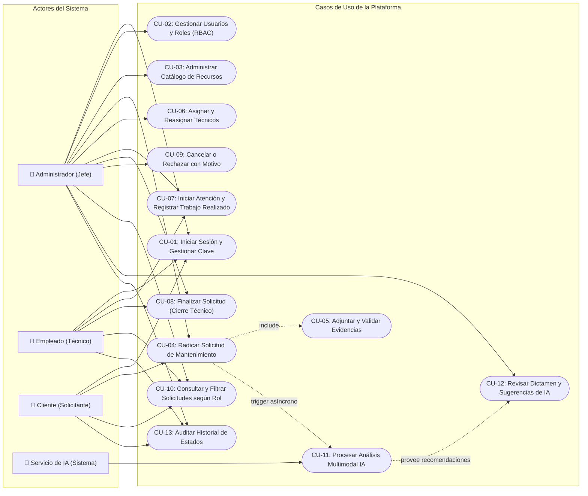
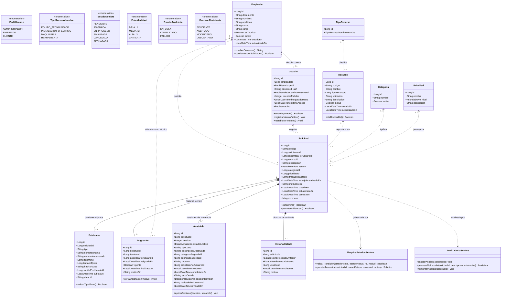
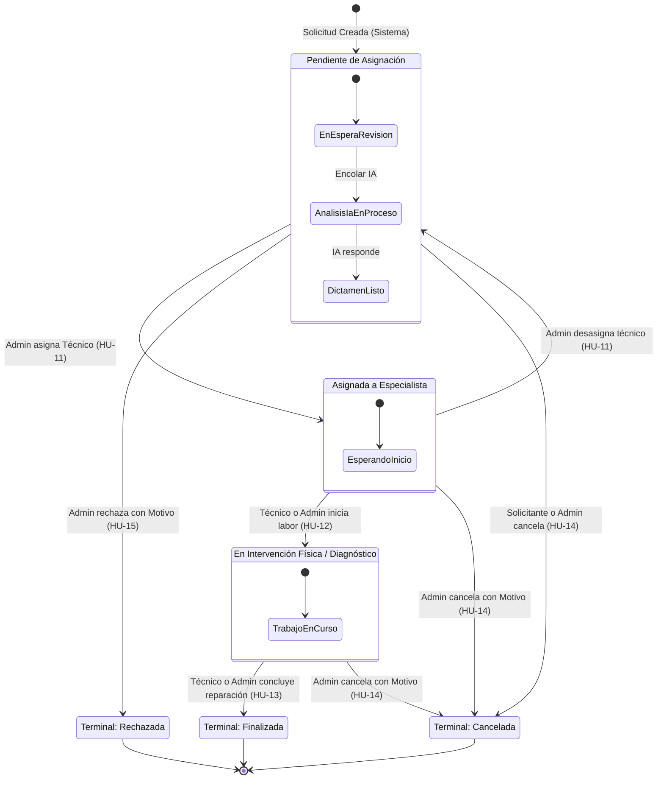
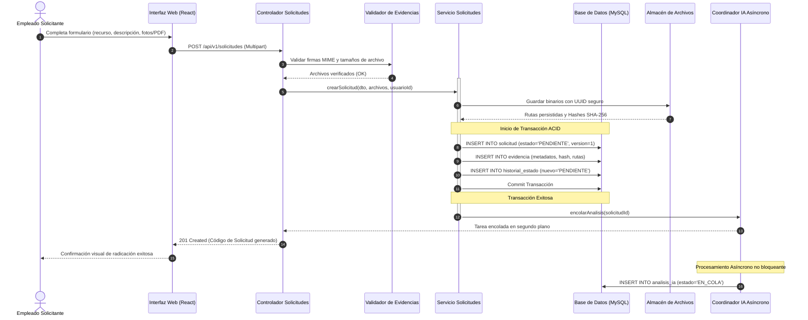
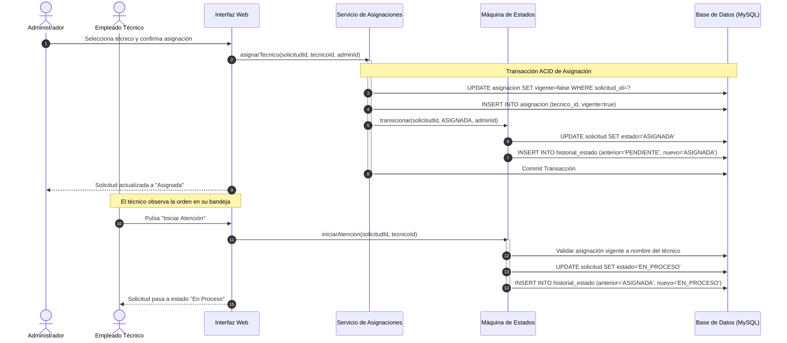
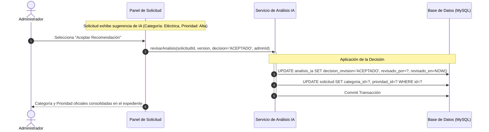

# DISEÑO DEL SISTEMA Y MODELADO UML

**PROYECTO:** PLATAFORMA DE GESTIÓN INTEGRAL DE SOLICITUDES DE MANTENIMIENTO CON ANÁLISIS ASISTIDO POR IA  
**DOCUMENTO:** Diagramas y Especificación de Diseño UML  
**VERSIÓN:** 1.1  
**FECHA DE EMISIÓN:** 14 de noviembre de 2026  
**ESTADO:** Aprobado para Fase de Construcción y Aseguramiento de Calidad (QA)  

---

## Tabla de Contenido
1. [Introducción y Fundamentación de Diseño](#1-introducción-y-fundamentación-de-diseño)
2. [Diagrama de Casos de Uso del Sistema](#2-diagrama-de-casos-de-uso-del-sistema)
   - 2.1 [Especificación y Trazabilidad de Casos de Uso](#21-especificación-y-trazabilidad-de-casos-de-uso)
3. [Diagrama de Clases del Dominio y Arquitectura](#3-diagrama-de-clases-del-dominio-y-arquitectura)
   - 3.1 [Diccionario y Responsabilidad de Clases](#31-diccionario-y-responsabilidad-de-clases)
4. [Diagrama de Estados de la Solicitud de Mantenimiento](#4-diagrama-de-estados-de-la-solicitud-de-mantenimiento)
5. [Diagramas de Secuencia de Procesos Críticos](#5-diagramas-de-secuencia-de-procesos-críticos)
   - 5.1 [Secuencia 1: Radicación de Solicitud con Evidencias y Disparo de IA](#51-secuencia-1-radicación-de-solicitud-con-evidencias-y-disparo-de-ia)
   - 5.2 [Secuencia 2: Asignación Técnica y Avance del Mantenimiento](#52-secuencia-2-asignación-técnica-y-avance-del-mantenimiento)
   - 5.3 [Secuencia 3: Revisión y Decisión Humana sobre Análisis de IA](#53-secuencia-3-revisión-y-decisión-humana-sobre-análisis-de-ia)
6. [Matriz de Trazabilidad: UML vs Requerimientos Funcionales (SRS)](#6-matriz-de-trazabilidad-uml-vs-requerimientos-funcionales-srs)
7. [Justificación de Decisiones de Diseño y Patrones Arquitectónicos](#7-justificación-de-decisiones-de-diseño-y-patrones-arquitectónicos)

---

## 1. Introducción y Fundamentación de Diseño

El presente documento expone la especificación arquitectónica y el diseño orientado a objetos de la **Plataforma de Solicitudes de Mantenimiento**, modelado bajo el Lenguaje Unificado de Modelado (**UML 2.5**).

El objetivo central de este modelado es formalizar la estructura estática, las interacciones dinámicas y el comportamiento temporal del software especificado en el [SRS.md](SRS.md). Cada clase, método, relación y caso de uso plasmado en este documento posee una correspondencia biunívoca con los Requerimientos Funcionales (**RF-01 a RF-20**) y las Historias de Usuario (**HU-01 a HU-20**).

Todos los diagramas están representados en sintaxis nativa **Mermaid** para garantizar su renderizado directo en entornos Markdown y repositorios de control de versiones, acompañados de descripciones analíticas que explican el *porqué* de cada decisión de ingeniería.

---

## 2. Diagrama de Casos de Uso del Sistema

El siguiente diagrama agrupa los casos de uso del sistema según la jerarquía de tres roles de usuario del ecosistema corporativo (**Administrador**, **Empleado (Técnico)** y **Cliente**) junto con el actor del sistema **Servicio de IA**:

### 2.1 Especificación y Trazabilidad de Casos de Uso

| Caso de Uso | Actores Primarios | Descripción y Propósito | Requerimiento Trazable |
| :--- | :--- | :--- | :--- |
| **CU-01: Registrarse, Iniciar Sesión y Gestionar Clave** | Visitante / Todos los usuarios | Permite el autorregistro de nuevos usuarios con rol `CLIENTE` (`POST /api/auth/register`, validación dual cliente/servidor, prevención de duplicados `HTTP 409`, hashing criptográfico `PBKDF2-HMAC-SHA256` con sal aleatoria e inicio de sesión automático), la autenticación de usuarios existentes, la recuperación de contraseña en dos pasos por correo electrónico (`/recuperar-contrasena` con código OTP de 6 dígitos) y el cambio de clave temporal si `debeCambiarPassword` está activo. | **RF-19**, **RNF-03**, **RNF-12** |
| **CU-02: Gestionar Usuarios y Roles (RBAC)** | Administrador | Permite crear, editar, activar/desactivar usuarios y asignar o cambiar sus roles dentro de la jerarquía (`ADMINISTRADOR`, `EMPLEADO`, `CLIENTE`). Bloqueado en UI y API (`HTTP 403`) para Empleados y Clientes. | **RF-01**, **RF-02**, **RF-03**, **RNF-04** |
| **CU-03: Administrar Catálogo de Recursos** | Administrador | Permite dar de alta, editar y categorizar los activos de la empresa en las cuatro tipologías canónicas (Equipo, Instalación, Maquinaria, Herramienta). | **RF-04** |
| **CU-04: Radicar Solicitud de Mantenimiento** | Cliente, Administrador | Permite emitir una nueva solicitud seleccionando un recurso activo, ingresando la descripción del daño y generando el código único de seguimiento. | **RF-05**, **RF-06** |
| **CU-05: Adjuntar y Validar Evidencias** | Cliente, Empleado (Técnico), Administrador | Proceso que valida que las fotos (JPEG/PNG) y PDF cumplan con límites de tamaño y tipo MIME, permitiendo soporte visual tanto del reporte inicial como de la reparación técnica. | **RF-07**, **RNF-05** |
| **CU-06: Asignar y Reasignar Técnicos** | Administrador | Asocia formalmente a un Empleado técnico activo con una solicitud, cerrando cualquier asignación anterior y mutando el estado a `Asignada`. | **RF-11**, **RNF-02** |
| **CU-07: Iniciar Atención y Registrar Trabajo Realizado** | Empleado (Técnico), Administrador | Transiciona la solicitud de `Asignada` a `En proceso` y permite documentar en el campo `trabajoRealizado` el detalle técnico de la intervención ejecutada sobre el activo. | **RF-12** |
| **CU-08: Finalizar Solicitud (Cierre)** | Empleado (Técnico), Administrador | Concluye la intervención técnica, registra la descripción del trabajo y sella la solicitud en el estado terminal `Finalizada`. | **RF-13** |
| **CU-09: Cancelar o Rechazar con Motivo** | Administrador | Permite dar de baja o desestimar solicitudes, exigiendo un texto de motivo obligatorio de al menos 10 caracteres. | **RF-14**, **RF-15** |
| **CU-10: Consultar y Filtrar Solicitudes según Rol** | Todos los usuarios | Provee la bandeja de solicitudes aplicando RBAC en interfaz y backend: el `CLIENTE` solo ve sus propias solicitudes sin datos de empleados ni de otros clientes; el `EMPLEADO` solo ve las solicitudes asignadas a él; el `ADMINISTRADOR` ve todas. | **RF-08**, **RF-09**, **RNF-04** |
| **CU-11: Procesar Análisis Multimodal IA** | Servicio de IA (Sistema) | Ejecución en segundo plano que analiza descripción y archivos binarios para inferir el tipo de daño y sugerir categoría y prioridad. | **RF-16**, **RF-17**, **RNF-06** |
| **CU-12: Revisar Dictamen y Sugerencias IA** | Administrador | Panel de soberanía humana para Aceptar, Modificar o Descartar las recomendaciones emitidas por la inteligencia artificial. | **RF-18** |
| **CU-13: Auditar Historial de Estados** | Todos los usuarios autorizados | Muestra la línea de tiempo inmutable con el registro cronológico de cada transición (con identidades anonimizadas de personal interno cuando consulta un `CLIENTE`). | **RF-20**, **RNF-11** |

---

## 3. Diagrama de Clases del Dominio y Arquitectura

El siguiente diagrama de clases modela la estructura lógica del dominio, encapsulando entidades, enumeraciones y servicios clave de la arquitectura modular:

### 3.1 Diccionario y Responsabilidad de Clases

- **`Empleado`:** Entidad central de nómina. Contiene la bandera `esTecnico`, permitiendo que cualquier empleado calificado asuma tareas operativas sin alterar la jerarquía de roles de seguridad.
- **`Usuario`:** Entidad de seguridad y autenticación. Implementa políticas defensivas (`intentosFallidos`, `bloqueadoHasta`, `debeCambiarPassword`). Vinculada estrictamente a un único empleado.
- **`Recurso`:** Representa el activo corporativo. Garantiza que toda falla se asocie a un código inventariable existente y a una ubicación física precisa.
- **`Solicitud`:** Agregado principal del dominio. Controla el código secuencial, los involucrados, el estado del ciclo de vida y el control de concurrencia optimista (`version`).
- **`Evidencia`:** Archivo binario adjunto. Mantiene el nombre desinfectado en disco, el hash criptográfico SHA-256 para prevenir manipulaciones y la auditoría de quién realizó la carga.
- **`Asignacion`:** Representa la vinculación entre una solicitud y un técnico. El modelo soporta múltiples asignaciones históricas pero impone que solo una permanezca con `vigente = true`.
- **`AnalisisIa`:** Modelo desacoplado que almacena los resultados emitidos por el modelo de IA. Versiona cada ejecución y resguarda la auditoría de la revisión humana (`decisionRevision`).
- **`HistorialEstado`:** Bitácora inmutable (*append-only*). Cada mutación de estado inserta un registro indeleble con usuario, estampa de tiempo y justificación.

---

## 4. Diagrama de Estados de la Solicitud de Mantenimiento

El siguiente diagrama formaliza la máquina de estados finitos que gobierna el ciclo de vida de cada solicitud:

---

## 5. Diagramas de Secuencia de Procesos Críticos

### 5.1 Secuencia 1: Radicación de Solicitud con Evidencias y Disparo de IA
Muestra el flujo transaccional atómico al momento en que un empleado radica un reporte:

### 5.2 Secuencia 2: Asignación Técnica y Avance del Mantenimiento
Ilustra la asignación manual por el Administrador y la transición operativa por el Técnico:

### 5.3 Secuencia 3: Revisión y Decisión Humana sobre Análisis de IA
Muestra la gobernanza humana sobre las inferencias de inteligencia artificial:

---

## 6. Matriz de Trazabilidad: UML vs Requerimientos Funcionales (SRS)

| Elemento UML (Clase / Método / Caso de Uso) | Requerimiento Funcional (SRS) | Historia de Usuario |
| :--- | :--- | :--- |
| `CU-01`, `Usuario.estaBloqueado()`, `Usuario.registrarIntentoFallido()` | **RF-19** (Autenticación y Clave Temporal) | **HU-18**, **HU-19** |
| `CU-02`, `Empleado`, `Usuario`, `Empleado.puedeAtenderSolicitudes()` | **RF-01**, **RF-02**, **RF-03** (Empleados y Usuarios) | **HU-01**, **HU-02**, **HU-03** |
| `CU-03`, `Recurso`, `TipoRecurso`, `Recurso.estaDisponible()` | **RF-04** (Catálogo de Recursos) | **HU-04** |
| `CU-04`, `Solicitud`, `Solicitud.esTerminal()` | **RF-05**, **RF-06** (Radicación Propia y Terceros) | **HU-05**, **HU-06** |
| `CU-05`, `Evidencia`, `Evidencia.validarTipoMime()` | **RF-07**, **RF-10** (Gestión de Evidencias Seguras) | **HU-07**, **HU-10** |
| `CU-06`, `Asignacion`, `Asignacion.cerrarAsignacion()` | **RF-11** (Asignación y Reasignación Técnica) | **HU-11** |
| `CU-07`, `CU-08`, `CU-09`, `MaquinaEstadosService` | **RF-12**, **RF-13**, **RF-14**, **RF-15** (Transiciones) | **HU-12**, **HU-13**, **HU-14**, **HU-15** |
| `CU-10`, `SolicitudFiltros`, paginación en bandeja | **RF-08**, **RF-09** (Consulta y Filtrado por Estado) | **HU-08**, **HU-09** |
| `CU-11`, `AnalisisIa`, `AnalizadorIaService.encolarAnalisis()` | **RF-16**, **RF-17** (Análisis IA y Sugerencias) | **HU-14**, **HU-15**, **HU-16** |
| `CU-12`, `AnalisisIa.aplicarDecision()` | **RF-18** (Supervisión Humana sobre IA) | **HU-17** |
| `CU-13`, `HistorialEstado` | **RF-20** (Bitácora de Auditoría Cronológica) | **HU-20** |

---

## 7. Justificación de Decisiones de Diseño y Patrones Arquitectónicos

1. **Patrón Monolito Modular en Capas frente a Microservicios:**
   - *Por qué:* El sistema atiende a una sola empresa con volumen moderado. Dividir la plataforma en microservicios independientes introduciría una sobrecarga operacional injustificada (redes complejas, consistencia eventual, orquestadores Kubernetes). El monolito modular provee separación de paquetes limpia con transacciones ACID locales garantizadas.
2. **Desacoplamiento de la Inteligencia Artificial mediante Tareas Asíncronas:**
   - *Por qué:* Los modelos de lenguaje y visión computacional presentan latencias variables (entre 2 y 15 segundos). Acoplar el análisis de forma síncrona en el endpoint de radicación bloquearía el hilo de ejecución HTTP del usuario. El uso de colas y el registro `analisis_ia` con estado `EN_COLA` / `COMPLETADO` asegura que la creación del reporte responda en menos de 500 ms.
3. **Máquina de Estados Centralizada en Servicio de Dominio:**
   - *Por qué:* Dispersar la lógica de transiciones en múltiples controladores visuales incrementa drásticamente el riesgo de transiciones ilegales por manipulación de peticiones HTTP. La clase `MaquinaEstadosService` centraliza en un único punto todas las reglas de negocio, autorizaciones y requerimientos de motivo.
4. **Almacenamiento de Archivos en Sistema de Archivos Dedicado frente a Base de Datos (BLOB):**
   - *Por qué:* Almacenar archivos pesados (hasta 10 MB por PDF) como BLOB en MySQL infla exponencialmente el tamaño de las copias de seguridad (*dumps*), satura el *buffer pool* de InnoDB y penaliza las consultas. El sistema guarda solo los metadatos y el hash SHA-256 en MySQL, residiendo los binarios en un volumen de almacenamiento dedicado y seguro.
