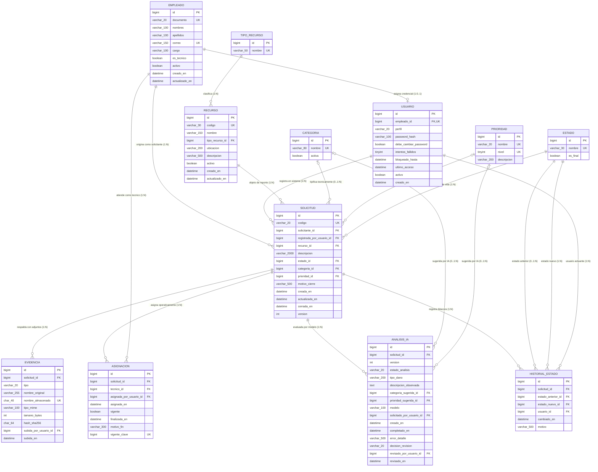

# MODELO ENTIDAD-RELACIÓN (MER) Y DICCIONARIO DE DATOS

**PROYECTO:** PLATAFORMA DE GESTIÓN INTEGRAL DE SOLICITUDES DE MANTENIMIENTO CON ANÁLISIS ASISTIDO POR IA  
**DOCUMENTO:** Modelo Entidad-Relación y Especificación de Persistencia Relacional  
**VERSIÓN:** 1.0  
**FECHA DE EMISIÓN:** 14 de noviembre de 2026  
**MOTOR DE BASE DE DATOS:** MySQL 8.4 LTS (Motor Transaccional InnoDB)  
**ESTADO:** Aprobado para Fase de Construcción y Aseguramiento de Calidad (QA)  

---

## Tabla de Contenido
1. [Introducción y Fundamentos de Persistencia](#1-introducción-y-fundamentos-de-persistencia)
2. [Diagrama Entidad-Relación (Mermaid)](#2-diagrama-entidad-relación-mermaid)
3. [Diccionario Exhaustivo de Datos](#3-diccionario-exhaustivo-de-datos)
   - 3.1 [Tabla: `empleado`](#31-tabla-empleado)
   - 3.2 [Tabla: `usuario`](#32-tabla-usuario)
   - 3.3 [Tabla: `tipo_recurso`](#33-tabla-tipo_recurso)
   - 3.4 [Tabla: `recurso`](#34-tabla-recurso)
   - 3.5 [Tabla: `categoria`](#35-tabla-categoria)
   - 3.6 [Tabla: `prioridad`](#36-tabla-prioridad)
   - 3.7 [Tabla: `estado`](#37-tabla-estado)
   - 3.8 [Tabla: `solicitud`](#38-tabla-solicitud)
   - 3.9 [Tabla: `evidencia`](#39-tabla-evidencia)
   - 3.10 [Tabla: `asignacion`](#310-tabla-asignacion)
   - 3.11 [Tabla: `analisis_ia`](#311-tabla-analisis_ia)
   - 3.12 [Tabla: `historial_estado`](#312-tabla-historial_estado)
4. [Reglas de Integridad Referencial y Restricciones Avanzadas](#4-reglas-de-integridad-referencial-y-restricciones-avanzadas)
5. [Estrategia de Indexación y Rendimiento de Consultas](#5-estrategia-de-indexación-y-rendimiento-de-consultas)
6. [Matriz de Trazabilidad: MER vs Requerimientos Funcionales (SRS)](#6-matriz-de-trazabilidad-mer-vs-requerimientos-funcionales-srs)
7. [Justificación de Decisiones de Modelado Relacional](#7-justificación-de-decisiones-de-modelado-relacional)

---

## 1. Introducción y Fundamentos de Persistencia

El presente documento define la especificación completa del modelo de datos relacional para la **Plataforma de Solicitudes de Mantenimiento**. El diseño ha sido estructurado para garantizar consistencia transaccional (**ACID**), cero redundancia de datos no controlada (conforme a la **Tercera Forma Normal - 3FN**) e integridad referencial inalterable para propósitos de auditoría operacional.

El modelo se implementa sobre el motor relacional **MySQL 8.4 LTS** utilizando exclusivamente tablas con motor de almacenamiento **InnoDB** y codificación de caracteres **`utf8mb4`** con cotejamiento **`utf8mb4_unicode_ci`**, lo que garantiza soporte completo para caracteres especiales, tildes y símbolos técnicos.

---

## 2. Diagrama Entidad-Relación (Mermaid)

El siguiente diagrama formaliza las 12 entidades del sistema, sus atributos primarios, claves foráneas y las cardinalidades de negocio que rigen sus relaciones:



---

## 3. Diccionario Exhaustivo de Datos

### 3.1 Tabla: `empleado`
* **Propósito:** Almacena el censo corporativo oficial de los colaboradores pertenecientes a la empresa.
* **Motor:** InnoDB \| **Cotejamiento:** `utf8mb4_unicode_ci`

| Columna | Tipo de Dato | Nulo | Clave / Restricción | Valor Defecto | Descripción y Reglas de Negocio |
| :--- | :--- | :---: | :---: | :---: | :--- |
| `id` | BIGINT UNSIGNED | NO | **PK**, AUTO_INCREMENT | N/A | Identificador primario secuencial del empleado. |
| `documento` | VARCHAR(20) | NO | **UNIQUE** | N/A | Cédula o documento de identidad oficial único. |
| `nombres` | VARCHAR(100) | NO | Ninguna | N/A | Nombres del colaborador. |
| `apellidos` | VARCHAR(100) | NO | Ninguna | N/A | Apellidos del colaborador. |
| `correo` | VARCHAR(150) | NO | **UNIQUE** | N/A | Correo electrónico institucional único. |
| `cargo` | VARCHAR(100) | NO | Ninguna | N/A | Posición o puesto desempeñado en la empresa. |
| `es_tecnico` | BOOLEAN | NO | Ninguna | `0` (false) | Marca funcional. `1` habilita al empleado para recibir asignaciones técnicas (HU-03). |
| `activo` | BOOLEAN | NO | Ninguna | `1` (true) | `1` activo, `0` inactivo. Los inactivos no pueden solicitar ni ser asignados. |
| `creado_en` | DATETIME(0) | NO | Ninguna | CURRENT_TIMESTAMP | Fecha y hora UTC del registro. |
| `actualizado_en`| DATETIME(0) | NO | Ninguna | CURRENT_TIMESTAMP | Fecha y hora UTC de la última modificación. |

---

### 3.2 Tabla: `usuario`
* **Propósito:** Credenciales y control de acceso seguro para autenticación al sistema.
* **Motor:** InnoDB \| **Cotejamiento:** `utf8mb4_unicode_ci`

| Columna | Tipo de Dato | Nulo | Clave / Restricción | Valor Defecto | Descripción y Reglas de Negocio |
| :--- | :--- | :---: | :---: | :---: | :--- |
| `id` | BIGINT UNSIGNED | NO | **PK**, AUTO_INCREMENT | N/A | Identificador único de la cuenta de usuario. |
| `empleado_id` | BIGINT UNSIGNED | NO | **FK**, **UNIQUE** | N/A | Enlace 1:1 con `empleado.id`. Restricción `ON DELETE RESTRICT`. |
| `perfil` | ENUM('ADMINISTRADOR','EMPLEADO') | NO | Ninguna | N/A | Perfil de acceso formal del usuario (RBAC). |
| `password_hash` | VARCHAR(100) | NO | Ninguna | N/A | Hash criptográfico seguro generado mediante algoritmo BCrypt (costo >= 10). |
| `debe_cambiar_password` | BOOLEAN | NO | Ninguna | `1` (true) | Si es `1`, fuerza la redirección al cambio de clave al iniciar sesión (RF-19). |
| `intentos_fallidos` | TINYINT UNSIGNED | NO | Ninguna | `0` | Contador de intentos fallidos. Al llegar a 5 bloquea temporalmente la cuenta. |
| `bloqueado_hasta` | DATETIME(0) | SÍ | Ninguna | NULL | Marca temporal hasta la cual se deniega el acceso tras bloqueo de seguridad. |
| `ultimo_acceso` | DATETIME(0) | SÍ | Ninguna | NULL | Estampa de tiempo del último inicio de sesión exitoso. |
| `activo` | BOOLEAN | NO | Ninguna | `1` (true) | Estado de la cuenta de usuario. |
| `creado_en` | DATETIME(0) | NO | Ninguna | CURRENT_TIMESTAMP | Fecha y hora UTC de creación de la cuenta. |

---

### 3.3 Tabla: `tipo_recurso`
* **Propósito:** Catálogo cerrado de las cuatro clases canónicas de activos físicos definidas por la organización.
* **Motor:** InnoDB \| **Cotejamiento:** `utf8mb4_unicode_ci`

| Columna | Tipo de Dato | Nulo | Clave / Restricción | Valor Defecto | Descripción y Reglas de Negocio |
| :--- | :--- | :---: | :---: | :---: | :--- |
| `id` | BIGINT UNSIGNED | NO | **PK**, AUTO_INCREMENT | N/A | Identificador del tipo de recurso. |
| `nombre` | VARCHAR(50) | NO | **UNIQUE** | N/A | Valores semilla inmutables: `Equipo tecnológico`, `Instalación o edificio`, `Maquinaria`, `Herramienta`. |

---

### 3.4 Tabla: `recurso`
* **Propósito:** Catálogo maestro de bienes físicos inventariables de la empresa.
* **Motor:** InnoDB \| **Cotejamiento:** `utf8mb4_unicode_ci`

| Columna | Tipo de Dato | Nulo | Clave / Restricción | Valor Defecto | Descripción y Reglas de Negocio |
| :--- | :--- | :---: | :---: | :---: | :--- |
| `id` | BIGINT UNSIGNED | NO | **PK**, AUTO_INCREMENT | N/A | Identificador único del recurso en base de datos. |
| `codigo` | VARCHAR(30) | NO | **UNIQUE** | N/A | Código de placa de activo o serial interno de inventario (ej. `EQ-TI-0014`). |
| `nombre` | VARCHAR(150) | NO | Ninguna | N/A | Nombre descriptivo del activo. |
| `tipo_recurso_id`| BIGINT UNSIGNED | NO | **FK** | N/A | Clave foránea a `tipo_recurso.id`. Restricción `ON DELETE RESTRICT`. |
| `ubicacion` | VARCHAR(200) | NO | Ninguna | N/A | Localización física precisa (sede, piso, nave, oficina o laboratorio). |
| `descripcion` | VARCHAR(500) | SÍ | Ninguna | NULL | Especificaciones técnicas complementarias o marca/modelo. |
| `activo` | BOOLEAN | NO | Ninguna | `1` (true) | `1` operativo, `0` dado de baja. Activos inactivos no pueden seleccionarse en nuevas solicitudes. |
| `creado_en` | DATETIME(0) | NO | Ninguna | CURRENT_TIMESTAMP | Fecha y hora de alta en inventario. |
| `actualizado_en`| DATETIME(0) | NO | Ninguna | CURRENT_TIMESTAMP | Última actualización de datos o ubicación. |

---

### 3.5 Tabla: `categoria`
* **Propósito:** Catálogo administrable de disciplinas técnicas para clasificar fallas de mantenimiento.
* **Motor:** InnoDB \| **Cotejamiento:** `utf8mb4_unicode_ci`

| Columna | Tipo de Dato | Nulo | Clave / Restricción | Valor Defecto | Descripción y Reglas de Negocio |
| :--- | :--- | :---: | :---: | :---: | :--- |
| `id` | BIGINT UNSIGNED | NO | **PK**, AUTO_INCREMENT | N/A | Identificador de categoría. |
| `nombre` | VARCHAR(80) | NO | **UNIQUE** | N/A | Nombre (semilla: Eléctrica, Mecánica, Hidráulica, Locativa/Estructural, Informática/Electrónica, Otra). |
| `activa` | BOOLEAN | NO | Ninguna | `1` (true) | Estado de disponibilidad en selectores. |

---

### 3.6 Tabla: `prioridad`
* **Propósito:** Catálogo jerárquico de niveles de severidad e impacto de las solicitudes.
* **Motor:** InnoDB \| **Cotejamiento:** `utf8mb4_unicode_ci`

| Columna | Tipo de Dato | Nulo | Clave / Restricción | Valor Defecto | Descripción y Reglas de Negocio |
| :--- | :--- | :---: | :---: | :---: | :--- |
| `id` | BIGINT UNSIGNED | NO | **PK**, AUTO_INCREMENT | N/A | Identificador de prioridad. |
| `nombre` | VARCHAR(20) | NO | **UNIQUE** | N/A | Valores semilla: `Baja`, `Media`, `Alta`, `Crítica`. |
| `nivel` | TINYINT UNSIGNED | NO | **UNIQUE** | N/A | Nivel numérico de ordenamiento (1=Baja, 2=Media, 3=Alta, 4=Crítica). |
| `descripcion` | VARCHAR(200) | NO | Ninguna | N/A | Criterio de impacto operacional que define el nivel de atención. |

---

### 3.7 Tabla: `estado`
* **Propósito:** Catálogo maestro cerrado que formaliza los seis estados canónicos de la máquina de estados.
* **Motor:** InnoDB \| **Cotejamiento:** `utf8mb4_unicode_ci`

| Columna | Tipo de Dato | Nulo | Clave / Restricción | Valor Defecto | Descripción y Reglas de Negocio |
| :--- | :--- | :---: | :---: | :---: | :--- |
| `id` | BIGINT UNSIGNED | NO | **PK**, AUTO_INCREMENT | N/A | Identificador del estado. |
| `nombre` | VARCHAR(30) | NO | **UNIQUE** | N/A | Valores semilla: `Pendiente`, `Asignada`, `En proceso`, `Finalizada`, `Cancelada`, `Rechazada`. |
| `es_final` | BOOLEAN | NO | Ninguna | `0` (false) | `1` para Finalizada, Cancelada y Rechazada. Los estados finales congelan la solicitud. |

---

### 3.8 Tabla: `solicitud`
* **Propósito:** Entidad raíz del expediente de mantenimiento que agrupa recurso, descripción, estados y responsables.
* **Motor:** InnoDB \| **Cotejamiento:** `utf8mb4_unicode_ci`

| Columna | Tipo de Dato | Nulo | Clave / Restricción | Valor Defecto | Descripción y Reglas de Negocio |
| :--- | :--- | :---: | :---: | :---: | :--- |
| `id` | BIGINT UNSIGNED | NO | **PK**, AUTO_INCREMENT | N/A | Identificador primario de la solicitud. |
| `codigo` | VARCHAR(20) | NO | **UNIQUE** | N/A | Código de negocio único generado (formato `SM-AAAA-NNNNNN`, ej. `SM-2026-000001`). |
| `solicitante_id` | BIGINT UNSIGNED | NO | **FK** | N/A | FK a `empleado.id`. Empleado que padece o reporta la falla. |
| `registrada_por_usuario_id` | BIGINT UNSIGNED | NO | **FK** | N/A | FK a `usuario.id`. Cuenta que ingresó el reporte (distingue captura directa de terceros). |
| `recurso_id` | BIGINT UNSIGNED | NO | **FK** | N/A | FK a `recurso.id`. Activo físico reportado. `ON DELETE RESTRICT`. |
| `descripcion` | VARCHAR(2000) | NO | Ninguna | N/A | Detalle minucioso de la anomalía observada (longitud mínima 20 caracteres). |
| `estado_id` | BIGINT UNSIGNED | NO | **FK** | N/A | FK a `estado.id`. Estado actual gobernado por la máquina de transiciones. |
| `categoria_id` | BIGINT UNSIGNED | SÍ | **FK** | NULL | FK a `categoria.id`. Asignada o aceptada oficialmente por el Administrador. |
| `prioridad_id` | BIGINT UNSIGNED | SÍ | **FK** | NULL | FK a `prioridad.id`. Nivel de criticidad oficial aprobado por el Administrador. |
| `motivo_cierre` | VARCHAR(500) | SÍ | Ninguna | NULL | Justificación obligatoria en cancelación/rechazo, u observación de cierre técnico. |
| `creada_en` | DATETIME(0) | NO | Ninguna | CURRENT_TIMESTAMP | Estampa de tiempo UTC de apertura del reporte. |
| `actualizada_en`| DATETIME(0) | NO | Ninguna | CURRENT_TIMESTAMP | Estampa de tiempo UTC de la última modificación. |
| `cerrada_en` | DATETIME(0) | SÍ | Ninguna | NULL | Estampa de tiempo UTC del pase a estado final (Finalizada, Cancelada, Rechazada). |
| `version` | INT UNSIGNED | NO | Ninguna | `1` | Campo de versión para bloqueo optimista (*Optimistic Locking*) en concurrencia. |

---

### 3.9 Tabla: `evidencia`
* **Propósito:** Almacena los metadatos y referencias criptográficas de los archivos fotográficos y documentales adjuntos.
* **Motor:** InnoDB \| **Cotejamiento:** `utf8mb4_unicode_ci`

| Columna | Tipo de Dato | Nulo | Clave / Restricción | Valor Defecto | Descripción y Reglas de Negocio |
| :--- | :--- | :---: | :---: | :---: | :--- |
| `id` | BIGINT UNSIGNED | NO | **PK**, AUTO_INCREMENT | N/A | Identificador único de la evidencia. |
| `solicitud_id` | BIGINT UNSIGNED | NO | **FK** | N/A | FK a `solicitud.id`. Expediente al que pertenece el adjunto. `ON DELETE CASCADE`. |
| `tipo` | ENUM('FOTOGRAFIA','PDF') | NO | Ninguna | N/A | Clasificación del archivo adjunto. |
| `nombre_original` | VARCHAR(255) | NO | Ninguna | N/A | Nombre original del archivo proporcionado por el usuario en su equipo. |
| `nombre_almacenado` | CHAR(40) | NO | **UNIQUE** | N/A | Identificador UUIDv4 desinfectado con el que se almacena físicamente en disco. |
| `tipo_mime` | VARCHAR(100) | NO | Ninguna | N/A | Tipo MIME validado por firma de cabecera (`image/jpeg`, `image/png`, `application/pdf`). |
| `tamano_bytes` | INT UNSIGNED | NO | Ninguna | N/A | Tamaño del archivo en bytes (máx. 5.242.880 para fotos, 10.485.760 para PDF). |
| `hash_sha256` | CHAR(64) | NO | Ninguna | N/A | Hash criptográfico SHA-256 para verificación de integridad y no repudio. |
| `subida_por_usuario_id`| BIGINT UNSIGNED | NO | **FK** | N/A | FK a `usuario.id`. Usuario responsable de anexar el documento. |
| `subida_en` | DATETIME(0) | NO | Ninguna | CURRENT_TIMESTAMP | Fecha y hora UTC de recepción del archivo. |

---

### 3.10 Tabla: `asignacion`
* **Propósito:** Modela la relación histórica y vigente entre una solicitud y el técnico asignado.
* **Motor:** InnoDB \| **Cotejamiento:** `utf8mb4_unicode_ci`

| Columna | Tipo de Dato | Nulo | Clave / Restricción | Valor Defecto | Descripción y Reglas de Negocio |
| :--- | :--- | :---: | :---: | :---: | :--- |
| `id` | BIGINT UNSIGNED | NO | **PK**, AUTO_INCREMENT | N/A | Identificador único del registro de asignación. |
| `solicitud_id` | BIGINT UNSIGNED | NO | **FK** | N/A | FK a `solicitud.id`. Orden sujeta a la labor técnica. |
| `tecnico_id` | BIGINT UNSIGNED | NO | **FK** | N/A | FK a `empleado.id`. Debe corresponder a un empleado activo con `es_tecnico = 1`. |
| `asignada_por_usuario_id`| BIGINT UNSIGNED| NO | **FK** | N/A | FK a `usuario.id`. Administrador que formalizó la orden de trabajo. |
| `asignada_en` | DATETIME(0) | NO | Ninguna | CURRENT_TIMESTAMP | Estampa temporal de inicio de la asignación. |
| `vigente` | BOOLEAN | NO | Ninguna | `1` (true) | `1` asignación activa, `0` finalizada o reasignada. |
| `finalizada_en` | DATETIME(0) | SÍ | Ninguna | NULL | Estampa temporal de finalización de esta asignación específica. |
| `motivo_fin` | VARCHAR(300) | SÍ | Ninguna | NULL | Justificación en caso de reasignación técnica o desasignación. |
| `vigente_clave` | BIGINT UNSIGNED | SÍ | **UNIQUE** | Columna Generada | `IF(vigente = 1, solicitud_id, NULL)`. Garantiza exactamente **una sola asignación vigente por solicitud**. |

---

### 3.11 Tabla: `analisis_ia`
* **Propósito:** Almacena el resultado desacoplado y versionado de las inferencias emitidas por el modelo de IA.
* **Motor:** InnoDB \| **Cotejamiento:** `utf8mb4_unicode_ci`

| Columna | Tipo de Dato | Nulo | Clave / Restricción | Valor Defecto | Descripción y Reglas de Negocio |
| :--- | :--- | :---: | :---: | :---: | :--- |
| `id` | BIGINT UNSIGNED | NO | **PK**, AUTO_INCREMENT | N/A | Identificador único de la corrida analítica. |
| `solicitud_id` | BIGINT UNSIGNED | NO | **FK** | N/A | FK a `solicitud.id`. Solicitud evaluada. |
| `version` | INT UNSIGNED | NO | **UNIQUE** (`solicitud_id`,`version`) | N/A | Número correlativo de versión de análisis (1, 2, 3...) por expediente. |
| `estado_analisis`| ENUM('EN_COLA','COMPLETADO','FALLIDO') | NO | Ninguna | 'EN_COLA' | Estado del procesamiento asíncrono en segundo plano. |
| `tipo_dano` | VARCHAR(200) | SÍ | Ninguna | NULL | Diagnóstico sintético deducido por la IA (ej. "Cortocircuito en bobina"). |
| `descripcion_observada`| TEXT | SÍ | Ninguna | NULL | Narrativa técnica detallada de lo detectado en fotos y documentos. |
| `categoria_sugerida_id`| BIGINT UNSIGNED| SÍ | **FK** | NULL | FK a `categoria.id`. Recomendación algorítmica de categoría. |
| `prioridad_sugerida_id`| BIGINT UNSIGNED| SÍ | **FK** | NULL | FK a `prioridad.id`. Recomendación algorítmica de severidad. |
| `modelo` | VARCHAR(100) | SÍ | Ninguna | NULL | Identificador del modelo de IA utilizado (ej. `gemini-2.5-flash-2026`). |
| `solicitado_por_usuario_id`| BIGINT UNSIGNED| SÍ | **FK** | NULL | Usuario que disparó el análisis inicial o el reintento. |
| `creado_en` | DATETIME(0) | NO | Ninguna | CURRENT_TIMESTAMP | Estampa de tiempo de encolado. |
| `completado_en` | DATETIME(0) | SÍ | Ninguna | NULL | Estampa de tiempo de respuesta efectiva del conector. |
| `error_detalle` | VARCHAR(500) | SÍ | Ninguna | NULL | Detalle técnico en caso de fallo HTTP o timeout. |
| `decision_revision`| ENUM('PENDIENTE','ACEPTADO','MODIFICADO','DESCARTADO') | NO | Ninguna | 'PENDIENTE' | Decisión oficial adoptada por el Administrador humano (HU-18). |
| `revisado_por_usuario_id`| BIGINT UNSIGNED| SÍ | **FK** | NULL | Administrador que emitió la decisión. |
| `revisado_en` | DATETIME(0) | SÍ | Ninguna | NULL | Fecha y hora UTC de la revisión humana. |

---

### 3.12 Tabla: `historial_estado`
* **Propósito:** Bitácora inmutable de auditoría forense (*append-only*) sobre todos los cambios de estado.
* **Motor:** InnoDB \| **Cotejamiento:** `utf8mb4_unicode_ci`

| Columna | Tipo de Dato | Nulo | Clave / Restricción | Valor Defecto | Descripción y Reglas de Negocio |
| :--- | :--- | :---: | :---: | :---: | :--- |
| `id` | BIGINT UNSIGNED | NO | **PK**, AUTO_INCREMENT | N/A | Identificador primario de la entrada de auditoría. |
| `solicitud_id` | BIGINT UNSIGNED | NO | **FK** | N/A | FK a `solicitud.id`. Solicitud modificada. |
| `estado_anterior_id` | BIGINT UNSIGNED | SÍ | **FK** | NULL | FK a `estado.id`. Estado saliente (NULL únicamente en creación inicial). |
| `estado_nuevo_id` | BIGINT UNSIGNED | NO | **FK** | N/A | FK a `estado.id`. Estado entrante validado por la máquina de transiciones. |
| `usuario_id` | BIGINT UNSIGNED | NO | **FK** | N/A | FK a `usuario.id`. Usuario que autorizó o ejecutó la mutación de estado. |
| `cambiado_en` | DATETIME(0) | NO | Ninguna | CURRENT_TIMESTAMP | Estampa de tiempo UTC exacta e inalterable del cambio. |
| `motivo` | VARCHAR(500) | SÍ | Ninguna | NULL | Justificación registrada (obligatoria en cancelaciones y rechazos). |

---

## 4. Reglas de Integridad Referencial y Restricciones Avanzadas

1. **Garantía Estricta de Asignación Única Vigente:**
   - *Mecanismo:* Debido a que MySQL tradicional no provee índices parciales condicionales (`WHERE vigente = true`), el modelo utiliza una **columna generada virtual o almacenada** en la tabla `asignacion`:
     ```sql
     vigente_clave BIGINT AS (IF(vigente = 1, solicitud_id, NULL)) STORED,
     UNIQUE KEY uq_asignacion_vigente (vigente_clave)
     ```
   - *Impacto:* Cuando `vigente = 1`, la columna toma el valor de `solicitud_id`. Como el índice `UNIQUE` permite múltiples valores `NULL`, pueden coexistir infinitas asignaciones no vigentes (`vigente = 0` &rarr; `NULL`), pero **solo una asignación vigente** para ese `solicitud_id`. Cualquier intento concurrente de insertar una segunda asignación activa colisionará a nivel de motor de base de datos con violación de unicidad.
2. **Restricción de Borrado en Cascada Selectivo (`ON DELETE RESTRICT`):**
   - Para prevenir la eliminación accidental de datos maestros, todas las claves foráneas hacia `empleado`, `usuario`, `recurso`, `tipo_recurso`, `categoria` y `prioridad` aplican `ON DELETE RESTRICT`. Solo los archivos de `evidencia` admiten `CASCADE` condicionado al borrado administrativo explícito de un expediente no procesado.
3. **Control de Concurrencia Optimista:**
   - La columna `version` en la tabla `solicitud` previene que dos administradores sobreescriban simultáneamente el estado de un expediente. Cada sentencia de actualización verifica `WHERE id = ? AND version = ?`, incrementando `version = version + 1`.

---

## 5. Estrategia de Indexación y Rendimiento de Consultas

Para dar pleno cumplimiento a los Requerimientos No Funcionales de tiempo de respuesta (**RNF-01**, consultas menores a 1.5 s sobre 20.000 registros), se establecen los siguientes índices compuestos estratégicos:

```sql
-- 1. Optimización para Bandeja de Solicitudes y Filtrado por Estado (HU-08, HU-09)
CREATE INDEX idx_solicitud_estado_fecha ON solicitud (estado_id, creada_en DESC);

-- 2. Optimización para Bandeja del Empleado Solicitante (HU-08)
CREATE INDEX idx_solicitud_solicitante_fecha ON solicitud (solicitante_id, creada_en DESC);

-- 3. Optimización para Bandeja de Tareas del Empleado Técnico (HU-19)
CREATE INDEX idx_asignacion_tecnico_vigente ON asignacion (tecnico_id, vigente);

-- 4. Optimización para Descarga y Validación de Evidencias (HU-10)
CREATE INDEX idx_evidencia_solicitud ON evidencia (solicitud_id);

-- 5. Optimización para Línea de Tiempo e Historial Forense (HU-20)
CREATE INDEX idx_historial_solicitud_fecha ON historial_estado (solicitud_id, cambiado_en ASC);

-- 6. Optimización para Versiones de Análisis de Inteligencia Artificial (HU-16)
CREATE UNIQUE INDEX uq_analisis_solicitud_version ON analisis_ia (solicitud_id, version);
```

---

## 6. Matriz de Trazabilidad: MER vs Requerimientos Funcionales (SRS)

| Entidad Relacional | Requerimientos Funcionales (SRS) | Historias de Usuario (HU) |
| :--- | :--- | :--- |
| `empleado` | **RF-01** (Registrar empleados), **RF-03** (Identificar función técnica) | **HU-01**, **HU-03** |
| `usuario` | **RF-02** (Administrar usuarios y perfiles), **RF-19** (Autenticación y clave) | **HU-02**, **HU-18**, **HU-19** |
| `tipo_recurso` | **RF-04** (Tipología canónica de activos) | **HU-04** |
| `recurso` | **RF-04** (Catálogo de recursos e inventario) | **HU-04** |
| `categoria` | **RF-17**, **RF-18** (Catálogo técnico de fallas) | **HU-16**, **HU-17** |
| `prioridad` | **RF-17**, **RF-18** (Escala de criticidad operacional) | **HU-16**, **HU-17** |
| `estado` | **RF-12**, **RF-13**, **RF-14**, **RF-15** (Catálogo de la máquina de estados) | **HU-12**, **HU-13**, **HU-14**, **HU-15** |
| `solicitud` | **RF-05**, **RF-06**, **RF-08**, **RF-09** (Gestión integral del expediente) | **HU-05**, **HU-06**, **HU-08**, **HU-09** |
| `evidencia` | **RF-07**, **RF-10** (Almacenamiento seguro e inspección de adjuntos) | **HU-07**, **HU-10** |
| `asignacion` | **RF-11** (Asignación manual y reasignación técnica) | **HU-11** |
| `analisis_ia` | **RF-16**, **RF-17**, **RF-18** (Inferencia multimodal y revisión humana) | **HU-14**, **HU-15**, **HU-16**, **HU-17** |
| `historial_estado` | **RF-20** (Bitácora cronológica inmutable de auditoría) | **HU-20** |

---

## 7. Justificación de Decisiones de Modelado Relacional

1. **Segregación entre `empleado` y `usuario`:**
   - *Justificación:* Permite reflejar la realidad corporativa donde no todos los empleados requieren interactuar directamente con la plataforma web (por ejemplo, personal operario que reporta verbalmente al administrador). Separar ambas entidades evita poblar campos de autenticación nulos en la nómina y permite suspender el acceso informático a un usuario sin eliminar su identidad como empleado de la empresa.
2. **Uso de Columna Generada para Asignación Vigente:**
   - *Justificación:* En sistemas CMMS tradicionales, la validación de un solo técnico activo suele cometerse en código de aplicación, siendo vulnerable a carreras críticas (*race conditions*) si dos administradores asignan al mismo tiempo. Al resolverlo mediante una columna generada con índice `UNIQUE`, el motor InnoDB bloquea físicamente la inserción concurrente a nivel de base de datos.
3. **Desacoplamiento Estricto de `analisis_ia` de los Atributos de `solicitud`:**
   - *Justificación:* La solicitud posee sus propios campos `categoria_id` y `prioridad_id` que rigen la operación. La IA posee `categoria_sugerida_id` y `prioridad_sugerida_id` en una tabla hija. Esto asegura el principio de **gobernanza humana**: la IA nunca altera por sí sola el expediente; solo sugiere, y el Administrador decide si acepta o modifica los valores.
4. **Almacenamiento Descentralizado de Binarios (Ruta + Hash en DB):**
   - *Justificación:* Almacenar archivos PDF e imágenes como BLOB dentro de MySQL multiplica por diez el tamaño de las tablas, degrada los buffers de memoria y hace inviables los respaldos diarios. Guardar el hash SHA-256 en la base de datos certifica la integridad del archivo sin saturar el motor relacional.
