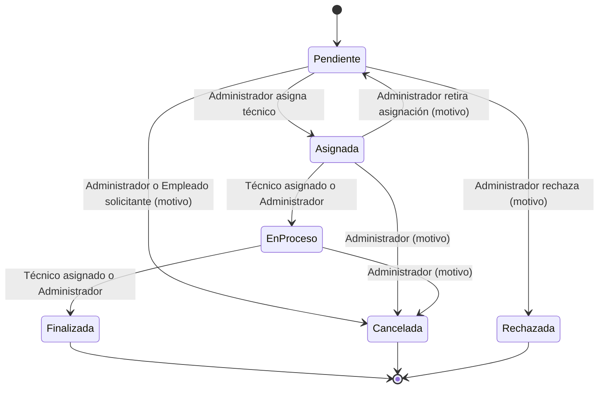

# User Flow: Plataforma de Solicitudes de Mantenimiento

Responsable: WILLIAM · Desarrollo individual · Java y MySQL · Versión 1.0 (borrador) · 14 de noviembre de 2026

## Convenciones y nombres canónicos

Este documento forma parte de un conjunto de cuatro ([PRD](PRD.md), [TRD](TRD.md), [PLAN](PLAN.md) y [User Flow](User-Flow.md)) que comparten los mismos nombres de actores, módulos, estados y requisitos. Cada afirmación lleva una de tres etiquetas:

- **Confirmado:** viene del mini SRS (decisiones confirmadas, RF/RNF confirmados).
- **Supuesto SU-xx:** decisión provisional que se propone para poder completar el documento porque la decisión pendiente (DP-xx) del SRS aún no está resuelta. Cada supuesto indica qué DP sustituye y debe validarse o reemplazarse.
- **Pendiente DP-xx:** decisión que el SRS deja expresamente abierta.

**Nombres canónicos usados en los cuatro documentos.**

- Actores: Administrador, Empleado (solicitante), Empleado Técnico (un Empleado con función técnica; no es un tercer perfil), Servicio de IA (actor de sistema).
- Estados: Pendiente, Asignada, En proceso, Finalizada, Cancelada, Rechazada.
- Módulos: M1 Gestión de usuarios, M2 Gestión de recursos, M3 Gestión de solicitudes, M4 Gestión de técnicos y asignaciones, M5 Seguimiento, M6 Análisis con IA.
- Entidades: Usuario, Empleado, Recurso, Tipo de recurso, Solicitud, Estado, Evidencia, Asignación, Análisis IA.

## 4.1 Convenciones

Este documento describe la navegación con nodos y conexiones suficientemente explícitos para dibujarlos en cualquier herramienta de diagramas.

- **P-xx:** pantalla o sección navegable. **D-xx:** decisión o bifurcación. **E-xx:** estado de error. **FIN-xx:** punto de llegada.
- **RC-xx:** recorrido crítico (ocho, los mismos que prueba el [TRD 2.12](TRD.md)). **RS-xx:** recorrido secundario de administración.
- Los actores y estados usan los nombres del [PRD](PRD.md): Administrador, Empleado, Empleado Técnico; Pendiente, Asignada, En proceso, Finalizada, Cancelada, Rechazada.
- Las reglas de permisos y de transición son las de [PRD 1.7](PRD.md) y 1.8 (provisionales, SU-03 y SU-04).

## 4.2 Inventario de pantallas

| ID | Pantalla | Ruta | Quién accede |
| --- | --- | --- | --- |
| P-01 | Inicio de sesión | `/login` | Anónimo |
| P-02 | Cambio obligatorio de contraseña | `/cuenta/contrasena` | Autenticado con contraseña temporal |
| P-03 | Inicio (panel según perfil) | `/` | Autenticado |
| P-04 | Nueva solicitud | `/solicitudes/nueva` | Empleado, Administrador |
| P-05 | Listado de solicitudes con filtro por estado | `/solicitudes` | Autenticado (contenido según matriz 1.7) |
| P-06 | Detalle de solicitud (datos, evidencias, análisis de IA, historial, acciones) | `/solicitudes/{id}` | Según matriz 1.7 |
| P-07 | Diálogo Asignar o reasignar técnico | sobre P-06 | Administrador |
| P-08 | Diálogo Cambiar estado (con campo de motivo cuando aplica) | sobre P-06 | Según tabla 1.8 |
| P-09 | Diálogo Revisar análisis de IA (aceptar, modificar, descartar) | sobre P-06 | Administrador |
| P-10 | Lista de empleados | `/admin/empleados` | Administrador |
| P-11 | Formulario de empleado (incluye marca de técnico) | `/admin/empleados/nuevo`, `/admin/empleados/{id}` | Administrador |
| P-12 | Usuarios (crear, activar o desactivar, restablecer contraseña) | `/admin/usuarios` | Administrador |
| P-13 | Lista de recursos | `/admin/recursos` | Administrador |
| P-14 | Formulario de recurso | `/admin/recursos/nuevo`, `/admin/recursos/{id}` | Administrador |
| P-15 | Categorías | `/admin/categorias` | Administrador |
| P-16 | Acceso denegado / No encontrado | `/error` | Autenticado |

**Contenido de P-03 por perfil:** Empleado: contador de sus solicitudes por estado, botón *Nueva solicitud*, sus 5 solicitudes más recientes. Empleado Técnico: lo anterior más el bloque *Asignadas a mí*. Administrador: contador de todas las solicitudes por estado (cada contador enlaza a P-05 filtrado), botón *Nueva solicitud*, accesos a P-10, P-12, P-13 y P-15.

## 4.3 Puntos de entrada y estado inicial

| Forma de llegar | Resultado |
| --- | --- |
| Dirección de la plataforma sin sesión | P-01 |
| Enlace directo a cualquier pantalla interna sin sesión (por ejemplo `/solicitudes/123`) | P-01; tras iniciar sesión se redirige a la dirección originalmente pedida, si el usuario tiene permiso; si no, a P-16 |
| Dirección de la plataforma con sesión activa | P-03 |
| `/login` con sesión activa | P-03 |
| Sesión expirada en cualquier pantalla | P-01 con el mensaje "Su sesión expiró, inicie sesión de nuevo" |
| Botón Atrás del navegador después de cerrar sesión | P-01 (las páginas internas no se almacenan en caché) |

**Qué ve un usuario anónimo frente a uno autenticado:** el anónimo ve únicamente P-01 (formulario de correo y contraseña, y el texto "¿Olvidó su contraseña? Comuníquese con el Administrador", por SU-08). El autenticado ve la barra de navegación de su perfil, su nombre, el botón *Cerrar sesión* y solo las opciones que su perfil permite; las opciones "Administración" no se muestran a Empleados.

## 4.4 Recorridos críticos

### RC-01. Inicio de sesión

**Actor:** cualquier usuario. **Origen:** punto de entrada de 4.3.

1. El usuario llega a **P-01** y escribe correo y contraseña.
2. **D-01 ¿Credenciales válidas y usuario activo y no bloqueado?**
   - **No, credenciales incorrectas → E-01:** mensaje "Correo o contraseña incorrectos" (no indica cuál); el correo se conserva y la contraseña se borra; vuelve a P-01. Al quinto intento consecutivo → E-02.
   - **No, cuenta bloqueada → E-02:** "Cuenta bloqueada temporalmente. Intente de nuevo en 15 minutos".
   - **No, usuario desactivado → E-03:** el mismo mensaje genérico de E-01 (no revela que la cuenta existe).
   - **Sí → D-02.**
3. **D-02 ¿Tiene contraseña temporal?** Sí → **P-02** (nueva contraseña de 10 o más caracteres con letra y número, con confirmación); no puede salir de P-02 sin cambiarla. Una vez cambiada, continúa. No → continúa.
4. **D-03 ¿Había una dirección pedida antes de iniciar sesión?** Sí → se abre esa pantalla si el perfil lo permite. No → **P-03**.

**Llegada: FIN-01** (P-03 del perfil, o la pantalla pedida). **Cierre de sesión:** el botón *Cerrar sesión* invalida la sesión y lleva a P-01 con "Sesión cerrada".

### RC-02. Empleado registra una solicitud propia

**Actor:** Empleado (o Empleado Técnico). **Origen:** P-03 → *Nueva solicitud*.

1. **P-04:** el sistema muestra los campos Recurso, Descripción y Evidencias. El solicitante es el propio usuario y no es editable.
2. El usuario elige el **recurso**: lista de recursos activos con búsqueda por nombre o código y filtro por tipo (Equipo tecnológico, Instalación o edificio, Maquinaria, Herramienta).
3. Escribe la **descripción** (contador de 20 a 2 000 caracteres).
4. Opcionalmente **adjunta** hasta 5 fotografías (JPEG o PNG, 5 MB) y 2 PDF (10 MB); cada archivo muestra vista previa o nombre, tamaño y botón *Quitar*.
5. Pulsa *Enviar solicitud*. El botón se desactiva y muestra "Enviando…" para evitar doble envío.
6. **D-04 ¿Validación correcta?**
   - **No → E-04:** se vuelve a P-04 conservando recurso, descripción y archivos válidos; el error aparece junto al campo ("Debe tener al menos 20 caracteres"; "Seleccione un recurso"; "foto3.bmp: formato no permitido"; "informe.pdf supera los 10 MB"; "Máximo 5 fotografías").
   - **Sí → paso 7.**
7. El sistema crea la solicitud en estado **Pendiente**, genera el código (por ejemplo `SM-2026-000123`) y encola el análisis de IA.
8. Se muestra **P-06** de la solicitud nueva con el mensaje de éxito "Solicitud SM-2026-000123 registrada", estado Pendiente, evidencias adjuntas y el indicador "Análisis de IA en proceso" (el Empleado ve el análisis cuando esté completado, solo lectura).

**Alternativos:**

- **Cancelar el formulario:** el botón *Cancelar* o el menú de navegación con datos escritos muestra "¿Descartar la solicitud? Se perderán los datos" con *Descartar* (va a P-03) y *Seguir editando*. Sin datos escritos sale directamente.
- **El recurso fue desactivado mientras se llenaba el formulario:** al enviar → E-04 con "El recurso seleccionado ya no está disponible"; se conserva lo demás.
- **Falla del servidor o de red durante el envío → E-05:** mensaje "No pudimos registrar la solicitud. Intente de nuevo"; el texto y el recurso se conservan, los archivos deben volver a seleccionarse (limitación del navegador). Si la solicitud ya se había creado, el reintento no la duplica (el formulario lleva un identificador de envío único; el sistema responde con la solicitud ya creada).
- **Sesión por expirar:** a los 28 minutos de inactividad aparece "Su sesión va a expirar" con *Seguir conectado*.

**Llegada: FIN-02** (P-06 de la solicitud creada). **Invitación posterior:** enlaces *Registrar otra solicitud* (P-04) y *Ver mis solicitudes* (P-05).

### RC-03. Administrador registra una solicitud en nombre de un empleado

**Actor:** Administrador. **Origen:** P-03 → *Nueva solicitud*.

Igual que RC-02, con estas diferencias en **P-04**:

1. Aparece el campo obligatorio **Solicitante**: búsqueda por nombre, documento o correo entre empleados activos.
2. **D-05 ¿Empleado seleccionado?** No → E-04 "Seleccione el empleado solicitante". Si la búsqueda no encuentra a nadie: "No hay empleados activos con ese criterio" con enlace a P-11 para registrarlo.
3. En **P-06** se muestra "Registrada por \[Administrador\] a nombre de \[Empleado\]", y el empleado la ve en su listado como propia.

**Llegada: FIN-03** (P-06). Acciones siguientes ofrecidas: *Asignar técnico* (RC-04) y *Registrar otra*.

### RC-04. Asignación de un técnico

**Actor:** Administrador. **Origen:** P-03 (contador Pendiente) → P-05 filtrado por Pendiente, o P-06 recién creada.

1. En **P-05** abre una solicitud Pendiente → **P-06**.
2. Pulsa *Asignar técnico* → **P-07**: lista de Empleados Técnicos activos (nombre, cargo y número de solicitudes que tienen en estado Asignada o En proceso).
3. **D-06 ¿Hay técnicos disponibles?** No → **E-06:** "No hay empleados marcados como técnicos" con enlace a P-10 para marcar uno (RS-01). Sí → paso 4.
4. Selecciona al técnico y pulsa *Asignar*.
5. **D-07 ¿La solicitud sigue Pendiente?** No (otro usuario la cambió) → **E-07 conflicto:** "La solicitud cambió mientras la editaba"; se recarga P-06 con el estado actual. Sí → se crea la asignación vigente y el estado pasa a **Asignada**; se registra en el historial.
6. **P-06** muestra el técnico asignado, estado Asignada y el mensaje de éxito.

**Alternativos desde Asignada:** *Cambiar técnico* (P-07; la asignación anterior se cierra y se crea una nueva, el estado sigue Asignada); *Retirar asignación* (P-08 con motivo obligatorio; la solicitud vuelve a **Pendiente**).

**Llegada: FIN-04** (P-06 con estado Asignada). Se invita a *Volver al listado de Pendientes* (P-05 filtrado) para continuar con la siguiente.

### RC-05. Atención por el Empleado Técnico

**Actor:** Empleado Técnico (o Administrador, que puede hacer lo mismo). **Origen:** P-03.

1. En **P-03**, el bloque *Asignadas a mí* lista sus solicitudes en Asignada y En proceso. Un clic abre **P-06**.
2. En P-06 revisa descripción, recurso, evidencias y análisis de IA (solo lectura).
3. Pulsa *Iniciar atención* → **P-08** confirma → estado **En proceso**.
4. Al terminar el mantenimiento pulsa *Finalizar* → **P-08** con campo opcional *Observación de cierre* (hasta 500 caracteres) → confirma → estado **Finalizada**.
5. **D-08 ¿La asignación sigue vigente?** No (el Administrador reasignó o retiró mientras tanto) → **E-07**: "Esta solicitud ya no está asignada a usted"; se recarga P-06 sin botones de acción.

**Llegada: FIN-05** (P-06 Finalizada, sin más acciones disponibles). Se invita a volver a *Asignadas a mí* (P-03).

**Alternativo:** el técnico intenta abrir por dirección una solicitud no asignada ni propia → **P-16** con "No encontrado".

### RC-06. Cancelación y rechazo con motivo

**Actores:** Administrador (cancelar y rechazar); Empleado (cancelar solo su solicitud Pendiente). **Origen:** P-06.

1. **D-09 ¿Qué acción y desde qué estado?** Según la tabla 1.8: *Rechazar* solo en Pendiente (Administrador); *Cancelar* en Pendiente, Asignada o En proceso (Administrador) y en Pendiente propia (Empleado). Los botones no disponibles no se muestran.
2. **P-08** pide el **motivo** (de 10 a 500 caracteres).
3. **D-10 ¿Motivo válido?** No → **E-04** "Indique el motivo (mínimo 10 caracteres)"; no cambia nada. Sí → paso 4.
4. **D-11 ¿El estado de origen sigue siendo válido?** No → **E-07** (conflicto) y recarga. Sí → el estado pasa a **Cancelada** o **Rechazada**; si había asignación vigente, se cierra; queda en el historial con motivo, usuario y fecha.
5. **P-06** muestra el estado final, el motivo y ningún botón de cambio.

**Llegada: FIN-06** (P-06 en estado Cancelada o Rechazada). El Empleado puede ver el motivo en el detalle de su solicitud.

### RC-07. Análisis de IA y su revisión

**Actores:** Servicio de IA (automático) y Administrador. **Origen:** creación de una solicitud (RC-02 o RC-03).

1. Tras crear la solicitud, el análisis pasa a **En cola**. **P-06** muestra la sección *Análisis de IA* con "En proceso" y se actualiza sola cada 5 segundos mientras esté abierta.
2. **D-12 ¿Resultado del análisis?**
   - **Completado:** la sección muestra tipo de daño, descripción observada, categoría sugerida y prioridad sugerida, con las etiquetas "Sugerencia de IA" y "Pendiente de revisión".
   - **Fallido → E-08:** "No se pudo completar el análisis" con el motivo breve; el Administrador ve *Reintentar* (genera una nueva versión) y la solicitud sigue siendo plenamente utilizable.
   - **IA deshabilitada:** "El análisis automático no está disponible"; sin botones.
3. El Administrador pulsa *Revisar* → **P-09**:
   - *Aceptar:* se copian categoría y prioridad sugeridas como finales.
   - *Modificar:* elige otra categoría y/u otra prioridad de las listas y guarda.
   - *Descartar:* no se aplica nada; categoría y prioridad finales quedan sin definir hasta fijarlas manualmente.
4. **D-13 ¿Se pidió una decisión válida?** Si falta elegir categoría o prioridad en *Modificar* → E-04 junto al campo. Si el análisis fue reemplazado por una versión más nueva → E-07 y recarga.
5. **P-06** muestra categoría y prioridad finales, la decisión y quién la tomó y cuándo.

**Alternativo:** si se agregan evidencias después del análisis, aparece *Solicitar nuevo análisis*; el anterior se conserva en la lista de versiones.

**Llegada: FIN-07** (P-06 con decisión registrada, o con análisis fallido y categoría y prioridad fijadas manualmente).

### RC-08. Consulta de solicitudes y evidencias

**Actores:** todos, con alcance según la matriz 1.7. **Origen:** P-03 o la barra de navegación.

1. **P-05:** listado paginado (20 por página, más recientes primero) con código, recurso, estado, solicitante, técnico y fecha. El Empleado ve las propias; el Técnico las propias y las asignadas; el Administrador todas.
2. El usuario aplica el **filtro de estado** (uno o varios de los seis); el total se actualiza. El Administrador puede filtrar además por solicitante, técnico y rango de fechas.
3. **D-14 ¿Hay resultados?** No → estado vacío (4.6). Sí → continúa.
4. Un clic en una fila abre **P-06**. La sección *Evidencias* muestra miniaturas de fotografías (clic para ampliar) y enlaces a los PDF (se abren en una pestaña o se descargan).
5. **D-15 ¿El usuario puede ver esa solicitud o archivo?** No → **P-16** "No encontrado" (se usa el mismo mensaje para existente y no existente). Sí → se muestra.

**Llegada: FIN-08** (P-06 consultada). Salidas: *Volver al listado* conserva filtros y página.

## 4.5 Recorridos secundarios (administración)

| ID | Recorrido | Pasos | Bifurcaciones y errores | Llegada |
| --- | --- | --- | --- | --- |
| **RS-01** | Alta de empleado, usuario y marca de técnico | P-10 → *Nuevo empleado* → P-11 (documento, nombres, apellidos, correo, cargo, casilla *Es técnico*) → Guardar → P-12 → *Crear usuario* (perfil Administrador o Empleado) → se muestra **una sola vez** la contraseña temporal | Documento o correo duplicado → error en el campo; al desmarcar técnico con solicitudes en Asignada o En proceso → aviso con la lista y bloqueo hasta reasignarlas; desactivar o degradar al último Administrador → bloqueado con explicación | FIN-09: P-10 con el empleado visible |
| **RS-02** | Gestión de recursos | P-13 → *Nuevo recurso* → P-14 (código, nombre, tipo, ubicación, descripción) → Guardar; para retirar: *Desactivar* | Código duplicado; recurso con solicitudes → solo se puede desactivar, no eliminar | FIN-10: P-13 actualizada |
| **RS-03** | Gestión de categorías | P-15 → agregar, renombrar o desactivar categoría | Nombre duplicado; desactivar una categoría usada → permitido, deja de ofrecerse pero se conserva en solicitudes y en el histórico | FIN-11: P-15 actualizada |
| **RS-04** | Restablecer contraseña | P-12 → *Restablecer contraseña* de un usuario → confirmación → contraseña temporal mostrada una vez; el usuario entra por RC-01 y pasa por P-02 | Usuario desactivado → la acción no está disponible | FIN-12: P-12 con mensaje de éxito |

## 4.6 Estados de la interfaz: carga, vacío y error

| Pantalla | Carga | Vacío | Error de validación o de sistema |
| --- | --- | --- | --- |
| P-01 | Botón con "Ingresando…" desactivado | No aplica | E-01, E-02, E-03 (mensajes en 4.4, RC-01) |
| P-03 | Esqueleto de contadores y listas | Empleado sin solicitudes: "Aún no tiene solicitudes. Registre la primera" con botón *Nueva solicitud*; Técnico sin asignadas: "No tiene solicitudes asignadas" | "No se pudo cargar el panel. Reintentar" con botón |
| P-04 | Cargas de recursos con "Cargando recursos…"; subida con barra de progreso por archivo | Sin recursos activos: "No hay recursos registrados. Pida al Administrador que registre uno" (el Administrador ve enlace a P-14) | Errores junto al campo; resumen arriba si hay varios; E-05 para fallas de servidor |
| P-05 | Esqueleto de filas | Sin solicitudes: "No hay solicitudes"; con filtro: "No hay solicitudes en estado \[estado\]" con enlace *Quitar filtro* | "No se pudo cargar el listado. Reintentar" |
| P-06 | Esqueleto del detalle; miniaturas con marcador de posición; sección de IA con indicador propio | Sin evidencias: "No se adjuntaron evidencias" (si el estado lo permite y el usuario tiene permiso, botón *Adjuntar*); sin análisis: "Aún no hay análisis" | E-07 por conflicto; E-08 por análisis fallido; archivo faltante: "No se encontró el archivo" |
| P-07 | Lista de técnicos con "Cargando…" | E-06 (sin técnicos) | Conflicto E-07 |
| P-08, P-09 | Botón de confirmación desactivado y "Guardando…" | No aplica | Motivo ausente o corto; decisión incompleta; conflicto E-07 |
| P-10, P-12, P-13, P-15 | Esqueleto de filas | "No hay \[empleados, usuarios, recursos, categorías\] registrados" con botón de alta | Duplicados, reglas del último Administrador y de técnico con solicitudes activas |
| P-16 | No aplica | No aplica | "No tiene permiso" o "No encontrado", con botón *Ir al inicio* (P-03) |

## 4.7 Casos límite transversales

| Situación | Comportamiento esperado |
| --- | --- |
| Sesión expira con un formulario a medias | El aviso a los 28 minutos permite seguir conectado; si expira, se va a P-01 y tras iniciar sesión se vuelve a la pantalla (sin conservar lo escrito) |
| Doble clic o doble envío | Botón desactivado y identificador de envío único; nunca se crean dos solicitudes iguales |
| Cae la conexión durante la subida de archivos | E-05; el texto se conserva; los archivos se vuelven a elegir |
| Usuario desactivado con sesión abierta | En su siguiente petición se cierra la sesión y va a P-01 |
| Empleado solicitante desactivado con solicitudes abiertas | Las solicitudes siguen su curso; el nombre se muestra con la etiqueta "(inactivo)" |
| Técnico desmarcado o desactivado con solicitudes asignadas | Se exige reasignar antes (RS-01); no quedan solicitudes Asignada o En proceso sin técnico vigente |
| Dos usuarios cambian la misma solicitud a la vez | El segundo recibe E-07 y ve el estado actual; no se pierde ni se pisa el primer cambio |
| Intento de transición no permitida por dirección directa | El servidor responde `TRANSICION_INVALIDA`; la interfaz muestra el mensaje y recarga |
| Solicitud en estado final | P-06 sin botones de cambio ni de adjuntar evidencias |
| Proveedor de IA lento o caído | La solicitud ya está registrada; el análisis queda En cola o Fallido (E-08); nunca bloquea otros flujos |
| Archivo con extensión engañosa | Rechazado por contenido, mensaje "formato no permitido" |
| Botón Atrás tras cerrar sesión | P-01; no se muestra contenido en caché |

## 4.8 Puntos de llegada por flujo

| Flujo | Llegada | Qué ve el usuario | Siguiente acción ofrecida |
| --- | --- | --- | --- |
| RC-01 | FIN-01 | P-03 de su perfil o la pantalla pedida | Según perfil |
| RC-02 | FIN-02 | P-06 con "Solicitud SM-… registrada", estado Pendiente | Registrar otra; ver mis solicitudes |
| RC-03 | FIN-03 | P-06 con "Registrada por … a nombre de …" | Asignar técnico; registrar otra |
| RC-04 | FIN-04 | P-06 con técnico y estado Asignada | Volver a Pendientes |
| RC-05 | FIN-05 | P-06 en estado Finalizada | Volver a Asignadas a mí |
| RC-06 | FIN-06 | P-06 en estado Cancelada o Rechazada con motivo | Volver al listado |
| RC-07 | FIN-07 | P-06 con categoría y prioridad finales y decisión registrada | Asignar técnico si está Pendiente |
| RC-08 | FIN-08 | P-06 consultada o P-05 filtrada | Volver al listado con filtros |
| RS-01 a RS-04 | FIN-09 a FIN-12 | Pantalla de administración actualizada | Continuar con otro registro |

## 4.9 Datos para dibujar el diagrama

**Diagrama de estados de la solicitud** (misma información que [PRD 1.8](PRD.md)), en formato Mermaid:

**Diagrama de navegación principal (aristas entre pantallas):**

| Desde | Hacia | Disparador |
| --- | --- | --- |
| P-01 | P-02 | Contraseña temporal |
| P-01, P-02 | P-03 | Inicio de sesión correcto |
| P-03 | P-04 | *Nueva solicitud* |
| P-03 | P-05 | Contador por estado, *Mis solicitudes*, *Asignadas a mí* |
| P-03 | P-10, P-12, P-13, P-15 | Accesos de administración (solo Administrador) |
| P-04 | P-06 | Envío correcto |
| P-04 | P-03 | *Descartar* |
| P-05 | P-06 | Clic en una solicitud |
| P-06 | P-07, P-08, P-09 | Acciones de asignación, estado y revisión de IA |
| P-07, P-08, P-09 | P-06 | Confirmar o cancelar |
| P-06 | P-05 | *Volver al listado* (conserva filtros) |
| P-10 | P-11 | Nuevo empleado o editar |
| P-11 | P-12 | Crear usuario del empleado |
| P-13 | P-14 | Nuevo recurso o editar |
| Cualquiera | P-16 | Sin permiso o no encontrado |
| Cualquiera | P-01 | Cerrar sesión o sesión expirada |

---

*Fin del documento. Todo supuesto SU-xx debe validarse o reemplazarse con la decisión del cliente (DP-xx); al cambiar una decisión se actualizan los cuatro documentos para conservar la coherencia de requisitos, historias, tareas y recorridos.*
